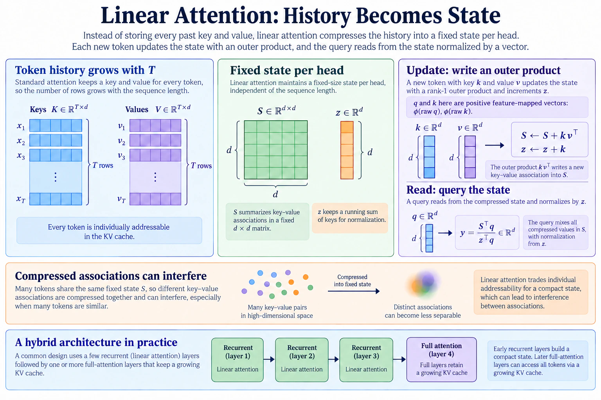
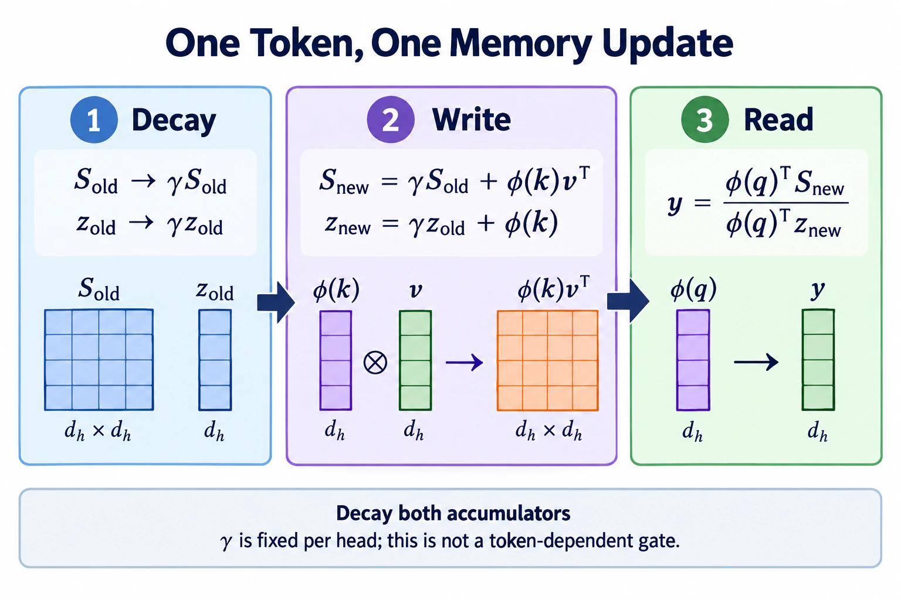

# Beyond — Linear attention and recurrent memory

> **Question this module answers:** *What changes when token-addressable history becomes a fixed recurrent state?*



Module 07's attention keeps every past token addressable, and Module 16's KV cache makes that growing history visible. Linear attention takes a more radical bargain: compress the past into fixed recurrent state. This module builds the smallest inspectable version of that bargain, tests its parallel and recurrent forms for equivalence, and measures what a recurrent/full-attention hybrid retains and loses. Use [the efficient-attention map](attention-efficiency.md) for the full taxonomy and [Beyond Sparse Attention](sparse-attention.md) for the sibling build that retains selected token access.

> **This is a Beyond module.** Beyond modules sit outside the numbered course: nothing in Modules 00–20 depends on them, and they are not part of finishing the course. Come here in any order, whenever a model card or paper names the idea and you want the load-bearing version — built, trained, and broken on your own machine.

---
## Before you start

* *Review*
	* [07-attention](../modules/07-attention.md) for the Q/K/V computation this module rearranges
	* [16-inference](../modules/16-inference.md) for the KV cache and why its growth is the problem
* *Finish*
	* `g2c/attention` ([07](../modules/07-attention.md) and [08](../modules/08-multi-head-attention.md))
	* `g2c/transformer` ([09-transformer-block](../modules/09-transformer-block.md))
	* `g2c/training` ([03b-training](../modules/03b-training.md))
* *Run*
	* `./datasets.sh --tiny` if the TinyStories corpus or `StoryTokenizer` artifact is missing
	* `G2C_APPLY_SOLUTIONS=01-16 ./notebook.sh linear-attention` instead of the plain launch if you're entering without your own implementations through cached inference

---
## Where this fits in

In Module 07 we built the all-to-all causal attention contract: every token can consult every previous token. In Module 16 we saw the inference bill that comes with it. A KV cache avoids recomputing old keys and values, but it does not make the history disappear. At history length `T`, each layer still stores `O(T)` state and reads and scores `O(T)` entries for the next token. Over a long generation, that per-token work accumulates.

Long-running agent trajectories and document-scale tasks make that bill increasingly visible. [The efficient-attention map](attention-efficiency.md) compares the distinct responses. Here we follow only the fixed-state branch: a factorizable similarity lets us reassociate attention into a running memory, then selective decay and delta rules show how production descendants make that memory more capable.

## The big idea

Linear attention starts by replacing softmax attention with a factorizable positive similarity, then changing the order of multiplication. Consider classic attention at one query position `t`, with the softmax removed for a moment:

```
   with softmax:      out_t = Σ_i  softmax(q_t·k_i) · v_i      ← must visit every i ≤ t

   without softmax:   out_t = q_t · ( Σ_i  k_i v_iᵀ )
                              ─────   ───────────────
                              (D,)       (D × D)
```

The entire trick *is* the reassociation. `Σ k_i v_iᵀ` doesn't depend on the query. It's just a running sum you can maintain incrementally, with one rank-one update per token:

```
   S_t = S_{t-1} + φ(k_t) v_tᵀ      # (D, D) state — the "memory"
   z_t = z_{t-1} + φ(k_t)           # (D,)   normalizer
   out_t = (φ(q_t) · S_t) / (φ(q_t) · z_t)
```

`φ` is a small positive feature map (we use `elu(x) + 1`) that provides a factorizable positive similarity in place of softmax's exponentiated dot-product similarity. The result is attention expressed as a *recurrent neural network (RNN)*. The whole past, regardless of sequence length, is compressed into a fixed-size matrix `S`.

The equations above describe one head and use `D` for readability. In the multi-head implementation, each head uses `d_h = D/H`. The complete state is `H` matrices of shape `(d_h, d_h)` plus `H` normalizer vectors: `H · d_h² + H · d_h = D²/H + D` values, independent of `T`.

The same computation now has **two forms**. Implementing both and proving they agree is the module's core deliverable:

```
   PARALLEL REFERENCE:                 RECURRENT (inference):

   all T tokens at once,               one token at a time,
   explicit T × T decay mask,          carry (S, z) forward
   full teacher forcing, but           O(D²/H) recurrent state work,
   still quadratic in T                O(1) memory in T

          └────────── same numbers, to floating-point tolerance ──────────┘
```

This mirrors a distinction you have already covered: Module 09's `forward` trains all positions in parallel, while Module 16's `forward_cached` generates incrementally. Linear attention makes the incremental attention operation independent of history length. The recurrent state update costs `O(D²/H)` across the heads; the surrounding dense projections still cost `O(D²)`. The “cache” becomes one fixed matrix per head instead of `T` growing entries.

There is an important implementation honesty line here. The course's `forward` uses the full `T × T` score and decay matrices because that makes the equivalence with `step` visible. It therefore does **not** provide linear-time or linear-memory training. Production systems use associative scans, chunking, and fused kernels to expose parallelism without materializing the full matrix. This module demonstrates the fixed-state inference result directly and explains, but does not implement, the production training kernel.

### What the compression costs

`S_t` is a compressed summary. Every key-value pair is superimposed into the same fixed matrix, so associations can interfere. Plausible consequences include:

* **Exact recall may degrade with distance.** Full attention retains an addressable key/value row for every token; the recurrent state superimposes them.
* **Copying and induction may weaken.** The induction pattern from Module 08 asks for an exact lookup, which is a demanding use of a fixed-capacity state.
* **Average next-token loss may hide the difference.** If most predictions in a corpus depend on nearby context, a relatively rare retrieval failure contributes little to the average. Exercises 2 and 3 test whether that story actually appears at StoryLM scale.

### Fixed decay versus an input-dependent gate

The recurrence above is the undecayed `γ = 1` case: it never forgets, so early tokens never fade and the magnitudes inside the state can keep growing. This module adds the smallest useful forgetting mechanism to **both** recurrent accumulators:

```
   S_t = γ_h · S_{t-1} + φ(k_t) v_tᵀ   # (d_h, d_h)
   z_t = γ_h · z_{t-1} + φ(k_t)         # (d_h,)
```

With `γ_h` below 1, every token handled by head `h` decays that head's old state by the same proportion. This is a *fixed learned decay*, not a content-dependent gate. It cannot decide that punctuation should be forgotten quickly while a name should persist. Modern gated recurrent layers compute a decay or write strength from the current token. Delta-rule variants also subtract what the state already predicts for a key before writing the corrected value. Those mechanisms are more selective; this module keeps one scalar per head so the recurrence and its parallel reference remain inspectable.


*Follow the matrix and normalizer together: decaying only one breaks the parallel/recurrent equivalence you test in the notebook. This fixed per-head decay is the baseline for the more selective writes below.*

### From fixed decay to KDA's gated delta write

The additive update above writes every new association on top of the same finite matrix. If two keys overlap, their values interfere; writing the new value does not first remove the old value that the state associates with that key. A delta-rule layer turns the state into a tiny online learner. In the orientation used by this module, its core can be read schematically as:

```text
prediction_t = k_tᵀ S_(t-1)                         # what memory says for this key
error_t      = v_t - prediction_t                   # what needs correcting
S_t          = G_t S_(t-1) + β_t k_t error_tᵀ      # forget, then corrective write
```

`β_t` controls how strongly the new association is written. `G_t` is a decay gate derived from the current token rather than one fixed `γ_h`; depending on the architecture it may act per head, per channel, or through a more structured transition. The important distinction is conceptual. Fixed decay says “this head forgets at one learned rate.” A gated delta write says “for this token, decay selected memory directions and change only the part of the association that is currently wrong.”

Kimi Delta Attention (KDA) is a production descendant of this rule. It refines Gated DeltaNet with finer-grained diagonal decay; deployed stacks can surround that recurrence with normalization, short convolution, chunkwise training algorithms, and fused kernels. GLM-5.3-Flash uses KDA for 34 of its 45 text layers. That does **not** make this module's `LinearAttention` a toy KDA: the course builds the fixed-state economics and parallel/recurrent equivalence, while KDA's selective transition remains a conceptual bridge.

### The hybrid pattern

Linear attention compresses history; full attention everywhere pays the full cache. A useful middle point is to stack mostly-linear layers with an occasional full-attention layer:

```
   layer 12:  linear      ┐
   layer 11:  linear      │  cheap, O(1)-state mixing
   layer 10:  linear      ┘
   layer  9:  FULL        ←  exact token access available; KV cache paid here
   layer  8:  linear      ┐
   ...                    ┘
```

The full layer makes exactly addressable token identities available to the residual stream; whether one such layer repairs a given task is empirical. The cache bill scales with the number and cache geometry of the full layers. Exercise 5 computes the contrast: at `D=4096`, one fp16 **MHA** layer needs about 16.4 GB of KV cache at one million tokens, GQA with eight KV heads needs about 4.1 GB, and one linear layer's `(S, z)` state is about 1.1 MB. A 3:1 hybrid pays a growing cache in one quarter of its layers, but the size of that cache still depends on whether those layers use MHA, GQA, or another compression scheme.

## Concepts to internalize

- **Linear attention uses a factorizable similarity.** Replace softmax with a positive feature kernel, regroup the computation, and each head's past collapses into a running `(d_h, d_h)` state.
- **One computation, two forms.** The readable parallel reference and recurrent inference form are equal to floating-point tolerance. The equivalence test is the module's anchor; the reference is not an efficient training kernel.
- **The state is a compressed summary.** Average loss and targeted recall measure different things; neither experiment's outcome should be assumed in advance.
- **A fixed decay is not a selective gate.** This module learns one forgetting rate per head. Token-dependent gates can choose what to retain based on content.
- **A delta write corrects an association instead of only adding another one.** It reads what the state currently predicts for a key and writes the residual error; KDA adds finer-grained, token-dependent decay around that idea.
- **Hybrids expose a dial.** Full layers retain exact token access and growing caches; recurrent layers use fixed state. The layer pattern chooses where to pay each cost.
- **A recurrent layer is one branch of efficient attention.** [The map](attention-efficiency.md) keeps its guarantees distinct from exact kernels, compressed token caches, and sparse selection.

### What we don't cover

- **State-space model derivations.** Mamba's selective-scan formulation arrives at a similar place from control theory. The convergence is the interesting fact; the HiPPO math is its own course.
- **Other efficient-attention families.** [The efficient-attention map](attention-efficiency.md) owns FlashAttention, MQA/GQA/MLA, sparse selection, and IndexPool.
- **Hardware-aware scan and chunked kernels.** Real implementations balance within-chunk parallelism against recurrent state passing. Our readable parallel reference materializes `T × T` scores, so it proves equivalence but does not realize efficient training.
- **KDA and other gated delta-rule implementations.** We trace the corrective write and selective-decay bridge, but keep a fixed per-head decay in the scaffold so the recurrent state and its parallel reference remain inspectable.
- **Recurrent-state commit and rollback.** A fixed summary has no token rows to truncate after rejected speculative drafts. [Beyond Speculative Decoding](specdec.md) explains checkpoint-plus-input replay as the serving bridge; neither module builds the production kernel.
- **Position embeddings under recurrence.** How RoPE-style rotations interact with state-based attention is a genuinely fiddly topic we sidestep by keeping Module 09's learned positions.

---
## What you'll build

Package: `g2c/linear_attention/`

```python
def feature_map(x): ...                  # implemented — elu(x) + 1

class LinearAttention(Module):
    embedding_dim: int
    num_heads: int
    # same Q/K/V/output projections as Module 08
    gamma_logit: torch.Tensor            # (H,) learned parameter
    decay: torch.Tensor                  # property: sigmoid(gamma_logit)

    def parameters(self): ...                                   # implemented
    def forward(self, x): ...                                   # SCAFFOLDED
        # parallel reference: explicit decayed T × T scores, all
        # positions at once; readable, but not an efficient train kernel
    def step(self, x_t, state): ...                             # SCAFFOLDED
        # recurrent/inference form: one token in, (S, z) carried
        # forward, one token out — must match forward() exactly

class HybridBlock(Module):               # Block with attn ∈ {full, linear}   # implemented
class HybridTransformerLM(Module):       # TransformerLM over a layer pattern  # implemented
    # pattern like ["linear", "linear", "linear", "full"] * repeats
```

Total scaffolded code: roughly 35 lines across two methods. `forward` and `step` are two views of one computation; when the equivalence test passes, you've understood the module.

## How to run the tests

Tests live in `tests/test_linear_attention.py`. Initial state: 8 passed (the provided feature map, construction, state shapes, accounting, and hybrid stacking), 7 failed.

```bash
source .venv/bin/activate

pytest tests/test_linear_attention.py              # all module tests
pytest tests/test_linear_attention.py -x           # stop at first failure (recommended)
pytest tests/test_linear_attention.py -k equiv     # parallel-vs-recurrent equivalence
pytest tests/test_linear_attention.py -k causal    # causality tests
pytest tests/test_linear_attention.py -v           # verbose
```

The anchor test: `test_parallel_matches_recurrent` runs the same sequence through `forward` and through repeated `step` calls and asserts the outputs agree. Mismatched normalization, state updated in the wrong order, or decay applied in only one form fails this test with a large, readable error. `test_forward_matches_undecayed_reference_at_gamma_one` separately prevents both forms from agreeing on the same unnormalized computation.

## Exercises

To launch the exercise notebook run:

```bash
./notebook.sh linear-attention
```

If at any point you want to archive the work in your current notebook and restart fresh:

```bash
./notebook.sh linear-attention --fresh
```

Written exercises live in the notebook as `Question:` / `Answer:` cells; ask a coding agent for hints or grading when you're ready, and partial submissions are fine — blank answers are skipped.

1. **Prove the equivalence, then benchmark decoding.** Verify parallel/recurrent equality. Compare one cached full-attention decoding step against one linear recurrent step over growing history lengths, with MPS synchronization and memory arithmetic. Report the observed crossover, including “none in this range.”
2. **Train the three-way comparison.** Train StoryLM-1M full attention, pure linear, and `[linear, linear, linear, full]` models on the 100MB TinyStories tier with near-identical parameter counts, batches, and step budgets. Compare validation loss and generated stories.
3. **The recall probe.** Train the same three architectural patterns on a synthetic key-value task and measure answer accuracy by retrieval distance. Treat every curve as data: explain what occurred rather than repairing it into the expected narrative.
4. **Inspect decay.** Compare state norms under fixed decay values, then inspect the per-head decays learned by the TinyStories models. Explain what a fixed per-head decay cannot do that an input-dependent gate can.
5. **Written: four versions of the 1M-token bill.** At `T=1M`, `D=4096`, `H=32`, compare the course's MHA cache, GQA with eight KV heads, an MHA layer retaining a 4096-token sliding window, and linear `(S, z)` state. Then total the four-layer all-MHA and `[L,L,L,F]` toy stacks and identify which states still grow with `T`.
6. **StoryLM-5M rerun (optional).** Repeat the TinyStories comparison at the StoryLM-5M architecture. It remains laptop-sized but makes the three-run block substantially longer.

## Pitfalls to expect

- **Dropping the normalizer `z`.** Outputs drift in scale with sequence length; training limps. Parallel/recurrent equivalence alone cannot catch an omission made in both forms, but `test_forward_matches_undecayed_reference_at_gamma_one` pins the normalized result explicitly.
- **State update order.** Whether you update `(S, z)` before or after computing the current token's output is the alignment seam: update-first lets a token attend to itself (correct, matching the parallel form); output-first silently shifts everything by one. The equivalence test pins this convention. Causality alone only proves that the future cannot affect the past.
- **Applying decay in one form but not the other.** The parallel form must implement the *same* geometric decay as `step` — via distance-dependent weights `γ^(t-i)` — or the equivalence test fails only for `γ < 1`, which reads as a mystery.
- **Timing asynchronous MPS work without synchronization.** The Python timer stops before Metal finishes and produces fiction. The notebook synchronizes before and after every measured region.
- **Comparing training and decoding timings.** A full teacher-forced pass and one recurrent token answer different questions. Exercise 1 compares one-token decode paths; the lesson separately explains why this module's training reference remains quadratic.
- **Promising a crossover or recall curve.** Kernel overhead, context range, optimization, and random seed all matter. “No crossover observed” and “hybrid did not recover the gap” are valid results when supported by the measurement.
- **Judging by average loss alone.** Even if losses are close, a targeted probe may separate the models; if it does not, that is also evidence about this model and task scale.

## M-series notes

- **Train with the parallel reference only.** The recurrent `step` in a Python loop throws away teacher-forcing parallelism. The reference is still quadratic in `T`; efficient linear-attention training needs a scan/chunk kernel outside this module's scope.
- **The equivalence check is CPU-comfortable; the full recall probe is a several-minute training block.** Its models and sequences are small, but the required path trains three four-layer variants for 600 steps. MPS is recommended for that cell.
- **Exercise 2's three StoryLM-1M runs are the compute cost of the required path.** StoryLM-5M is an optional rerun. Plug in for either sustained training block.
- **MPS and the parallel reference.** Its explicit score and decay matrices can be memory-hungrier than standard attention at the same `T`. If memory pressure bites, halve the batch before shrinking the model.

---
## Reading

Linear and recurrent core:

- **Katharopoulos, Vyas, Pappas, Fleuret, ["Transformers are RNNs"](https://arxiv.org/abs/2006.16236) (2020).** The reassociation trick, the feature map, and the parallel/recurrent duality — this module is §3 of this paper, built. Read it first for the implementation branch.
- **Schlag, Irie, Schmidhuber, ["Linear Transformers Are Secretly Fast Weight Programmers"](https://arxiv.org/abs/2102.11174) (2021).** Reframes the state as a fast-weight memory and introduces the delta-rule update — the error-correcting write behind the DeltaNet/KDA lineage.
- **Gu, Dao, ["Mamba: Linear-Time Sequence Modeling with Selective State Spaces"](https://arxiv.org/abs/2312.00752) (2023).** The state-space route to the same destination. Read for the convergence, skim the derivations.

Further bridges:

- **Yang, Kautz, Hatamizadeh, ["Gated DeltaNet"](https://arxiv.org/abs/2412.06464) (2024).** Decay gating plus the delta rule; the cleanest bridge from this module's code to the mechanism used in Qwen3.5's linear-attention layers.
- **Kimi Team, ["Kimi Linear: An Expressive, Efficient Attention Architecture"](https://arxiv.org/abs/2510.26692) (2025).** KDA's finer-grained diagonal decay and its chunkwise algorithm. Read the recurrence for the bridge; do not mistake the fused implementation for this module's reference code.
- **Sun, Dong, Huang et al., ["Retentive Network"](https://arxiv.org/abs/2307.08621) (2023).** An independent derivation of decay-gated linear attention; useful second angle on why the decay is load-bearing.

Optional:

- **2026 release examples.** [Kimi K3](https://www.kimi.com/news/kimi-k3-open-source) reports 69 KDA and 24 Gated-MLA layers, arranged as a 3:1 hybrid plus a final MLA layer. The official [Qwen3.5-9B model page](https://huggingface.co/Qwen/Qwen3.5-9B) reports eight repeats of three Gated DeltaNet layers followed by one gated full-attention layer. [GLM-5.3-Flash](https://z.ai/blog/glm-5.3-flash) publishes a `[KDA,KDA,KDA,DSA] × 11 + KDA` weave and adds IndexPool on the sparse index. These are production descendants of the fixed-state/full-attention trade, not reproductions of this module's update rule.
- **Gu, Goel, Ré, ["Efficiently Modeling Long Sequences with Structured State Spaces"](https://arxiv.org/abs/2111.00396) (S4, 2021).** Where the SSM lineage began, if the control-theory route appeals.

## Deliverable checklist

- [ ] All tests in `tests/test_linear_attention.py` pass — the parallel/recurrent equivalence especially.
- [ ] Notebook: honest cached-decoding benchmark (Exercise 1), StoryLM-1M three-way comparison with generated stories (Exercise 2), and empirical recall-vs-distance probe (Exercise 3).
- [ ] Written answer for the 1M-token memory bill (Exercise 5).
- [ ] You can explain — out loud, without notes — what reassociating `(qKᵀ)V` into `q(KᵀV)` buys, and what the softmax's removal costs.
- [ ] You can explain — out loud, without notes — why hybrid stacks exist, in terms of what the recurrent state cannot do.
- [ ] You can explain — out loud, without notes — why this module's recurrent inference state is fixed-size while its readable parallel training reference is still quadratic.
- [ ] You can explain — out loud, without notes — how a fixed per-head decay differs from an input-dependent gate.
- [ ] You can explain — out loud, without notes — how a delta-rule write corrects the state's current prediction, and why this module does not claim to implement KDA.
