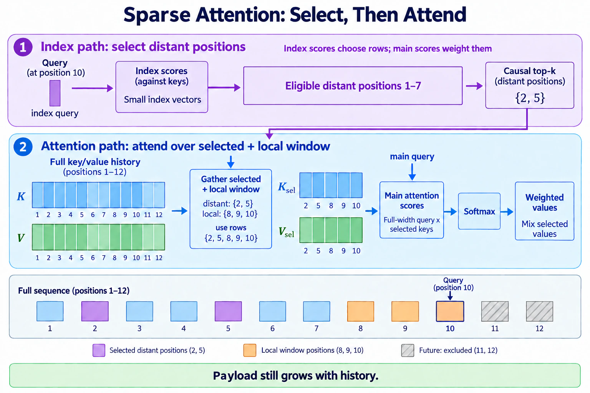
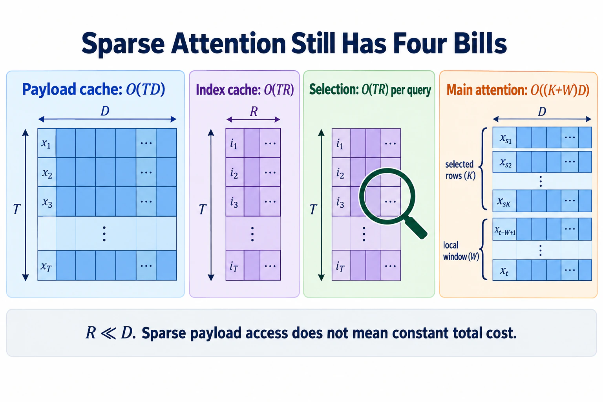

# Beyond — Sparse attention and learned selection

> **Question this module answers:** *How can attention keep the past addressable without consulting every past token?*



Full attention keeps every past token available and pays to compare every query with all of them. Linear attention takes the opposite bargain: replace those rows with fixed recurrent state. Sparse attention keeps a token-addressable history but chooses which rows each query may inspect. This module builds the smallest honest version of learned selection: a lightweight index, hard causal top-k retrieval, an exact local window, and attention over the gathered payload. It also measures the bills that sparsity does **not** remove.

> **Draft status.** This is a proposed Beyond module specification. Its package, tests, notebook, and rubric do not exist yet; the API and exercise counts below are design targets rather than a runnable assignment.

> **This is a Beyond module.** Beyond modules sit outside the numbered course: nothing in Modules 00–20 depends on them, and they are not part of finishing the course. Come here whenever a model card names sparse, selected, compressed, or indexed attention and you want to separate those claims.

---
## Before you start

* *Review* [07-attention](../modules/07-attention.md) for causal Q/K/V attention and mask-before-softmax
* *Review* [08-multi-head-attention](../modules/08-multi-head-attention.md) for per-head projections and attention weights
* *Review* [16-inference](../modules/16-inference.md) for the growing KV cache
* *Review* [The efficient-attention map](attention-efficiency.md) for the distinction between narrower caches, selected access, and fixed recurrent state
* *Finish* `g2c/attention` ([07](../modules/07-attention.md) and [08](../modules/08-multi-head-attention.md))
* *Run* `G2C_APPLY_SOLUTIONS=01-16 ./notebook.sh sparse-attention` instead of the plain launch if you're entering without your own implementations through cached inference

---
## Where this fits in

Module 07 establishes the dense causal contract: at position `t`, a query may attend to every position `s ≤ t`. Module 16 makes the inference cost concrete. Caching avoids recomputing old keys and values, but every new query still reads and scores a history whose length grows with `T`.

[Beyond Linear Attention](linear-attention.md) removes that growing row store from recurrent layers. Its state is fixed in `T`, but individual past tokens are no longer exactly addressable. Sparse attention occupies the other branch:

```text
                         how is history represented?

full attention       every token row, visit every eligible row
sparse attention     every token row, visit a selected subset
linear attention     fixed recurrent state, no individual token rows
```

This is not a minor implementation difference. A sparse layer can retrieve one distant token exactly if its selector finds that token. Its payload cache still grows with the history, and finding candidates creates a second problem: the index must be cheaper than the attention it avoids.

The mechanism now recurs centrally across independent released model families. DeepSeek-V3.2 introduced a lightweight indexer and selected-token attention; later DeepSeek designs combine selection with grouped compression and local windows. GLM-5/5.2 adopted DSA over an MLA-compressed payload and added cross-layer index sharing; GLM-5.3-Flash interleaves those sparse layers with recurrent KDA and pools index keys separately from the payload. That recurrence clears the Beyond threshold. The course build isolates the shared contract rather than reproducing any one production stack.

## The big idea

### A cheap score chooses where the expensive score runs

Ordinary attention computes a full-dimensional score for every eligible pair:

```text
main score(t, s) = q_t · k_s / √d_h       for every s ≤ t
```

Learned sparse attention introduces smaller index vectors of width `R`, with `R << D`, and uses them only to choose candidates:

```text
index score(t, s) = qi_t · ki_s / √R      for every s ≤ t
selected_t        = top-k(index score(t, :))
output_t          = Attn(q_t, K[selected_t], V[selected_t])
```

The index score is not the attention weight. It is a routing estimate whose job is to preserve the rows that full attention would have found useful. After selection, the ordinary Q/K score still determines the softmax weights over the gathered payload.

Keep the two spaces visually separate:

```text
x_t ──► small qi_t ─┐
                    ├─ index scores ─► causal top-k positions ─┐
x_s ──► small ki_s ─┘                                         │
                                                              ▼
x_t ──► full q_t ───────────────────────────────────────► attention
x_s ──► full k_s, v_s ─► payload cache ─► gather positions ───┘
```

This module shares one selection across the query heads. That makes the selected payload rows a coherent object and avoids pretending that `H` disjoint head selections cost the same cache traffic as one shared set. Production MQA/GQA systems make the same hardware concern load-bearing, although their indexers are more specialized than this one.

### Hard top-k creates a training seam

`topk` returns discrete indices. The language-model loss can train the Q/K/V projections used after selection, but it cannot differentiate through the choice of one payload row instead of another. A learned indexer therefore needs its own signal.

The readable course path uses dense attention as a teacher. For each query, detach the dense main-attention distribution, combine its heads into one target distribution `p_t`, and train the index logits `I_t` to match it:

```text
p_t          = detach(mean_h(dense_attention_weights[t, h, :]))
index_loss   = KL(p_t || softmax(I_t))
```

The notebook uses two stages so the causal story remains visible:

1. **Indexer warm-up.** Freeze the main attention path, run dense attention, and train only the small indexer against the detached target.
2. **Sparse adaptation.** Turn on hard selection, train the main model with language-model loss, and continue training the indexer with its separate alignment loss.

This is a mechanism-scale analogue of the dense warm-up and sparse adaptation disclosed for DSA, not a reproduction of its exact multi-head ReLU indexer, optimizer partition, token budget, or production kernel.

### Local access is a contract, not a hoped-for selection

Top-k retrieval can miss the immediately preceding token. Language has so much local structure that making nearby context compete with the whole history is an unnecessary failure mode. The course selector therefore takes the union of two sets:

```text
selected history for query t
    = last W eligible positions
      ∪ top-k distant positions from the learned index
```

The union is causal, deduplicated, and padded with a validity mask for early positions. Local rows are guaranteed rather than merely likely. The index can spend its limited `k` on distant retrieval.

This is deliberately simpler than Native Sparse Attention. NSA computes separate compressed, selected, and sliding-window branches and combines their outputs with learned gates. The course has one gathered payload path so the selection contract stays inspectable. An extension exercise adds block selection and compares it with token-level selection.

### Sparse attention has at least four bills

Let the payload head width be `d_h`, the shared index width be `R`, the selected distant count be `K`, and the exact local window be `W`. At decode position `T`, the course design retains:

```text
payload cache      O(T · D) values       full token rows still survive
index cache        O(T · R) values       smaller keys used for routing
selection work     O(T · R) per query    score the readable flat index
attention work     O((K + W) · D)        score and mix gathered payload
```

The selected attention work is bounded in `T` when `K` and `W` are fixed. The payload and index caches still grow. The flat readable index also scans all `T` index keys, so it reduces the expensive payload attention without making the entire algorithm constant-time or sublinear in history.

Production designs attack that remaining line in different ways: hierarchical or block indices, pooled index keys, cross-layer reuse, compressed payload entries, or hardware-aligned kernels. Those mechanisms shrink different objects. “Top-k 2048” alone does not reveal the payload width, index size, selection cost, cache traffic, or latency.


*With fixed K and W, only the final gathered-attention bill stops growing with history. Keep these four costs separate when interpreting the notebook's timing results.*

### Gathering fewer rows is not automatically faster

The course implementation uses ordinary PyTorch `topk`, `gather`, and small matrix multiplications. At its short sequence lengths, dense attention may be faster because it maps to mature contiguous kernels while sparse selection adds launches and irregular reads. That is an expected result, not a failed exercise.

Useful sparsity on hardware is often blockwise. Fetching a few contiguous blocks gives kernels regular work; fetching unrelated individual tokens may save arithmetic while wasting memory bandwidth and scheduling capacity. The notebook measures both token-level and block-level variants, but it does not claim a production speedup without a fused sparse kernel.

## Concepts to internalize

- **Sparse attention preserves token-addressable history.** Unlike recurrent linear attention, selected payload rows remain individually retrievable.
- **The index is not the payload.** Index vectors decide where to look; full attention keys and values supply what is read.
- **The index score is not the final attention score.** Selection routes; Q/K softmax weights the selected contents.
- **Hard selection needs a training story.** Language-model gradients do not pass through integer top-k indices; the course indexer learns from a detached dense-attention target.
- **Local and retrieved access solve different problems.** A guaranteed window handles nearby structure while learned selection searches distant history.
- **Sparsity does not imply a bounded cache.** Payload and index state can both grow with `T` even when selected attention work is fixed.
- **Selection can remain linear in history.** A cheap full scan is cheaper, not asymptotically gone. Hierarchies and pooled indices address a different bill.
- **Block structure is a systems property.** Equal selected-token counts can produce different memory traffic depending on whether the rows are contiguous and shared across heads.
- **Dense equivalence needs a precise limit.** When the selected set contains every eligible position, gathered sparse attention must match dense causal attention.
- **Model-card literacy:** ask for payload width, index width, selection granularity, `k`, local window, cache growth, training signal, execution phase, and kernel before interpreting “sparse.”

### What we don't cover

- **A production sparse-attention kernel.** The readable PyTorch path exposes selection and gathering; Triton, Metal, and fused backward operators belong to a performance lab.
- **Exact NSA, DSA, CSA, HCA, MLA, IndexShare, or IndexPool.** The module builds their shared selection economics and labels every production-specific step as a bridge.
- **End-to-end efficient sparse training.** Dense teacher targets and the readable flat index materialize quadratic score tensors during warm-up. The build teaches how selection learns, not a low-memory training kernel.
- **A compressed payload implementation.** Compressing K/V rows changes what is stored and later reconstructed. The accounting exercise covers it, while the core build keeps payload rows exact so selection errors are separable from compression loss.
- **Approximate nearest-neighbor infrastructure.** Vector databases, hashing, and tree indices add systems machinery without clarifying the attention contract at this scale.
- **A claim that attention weights are ground-truth relevance.** The dense teacher transfers one model's current routing behavior. It does not turn attention maps into semantic explanations.

---
## What you'll build

Planned package: `g2c/sparse_attention/`

```python
def causal_select(
    index_scores, *, top_k, window_size
): ...                                               # SCAFFOLDED
    # (B,T,T) scores → indices, valid mask of shape (B,T,S)
    # union causal distant top-k with an exact local window;
    # deduplicate and pad early rows without leaking the future

def gathered_attention(q, k, v, indices, valid): ... # SCAFFOLDED
    # q: (B,H,T,d_h), k/v: (B,H,T,d_h)
    # gather only selected payload rows, mask padding before softmax,
    # and return outputs plus selected attention weights

def index_alignment_loss(index_scores, dense_weights): ... # SCAFFOLDED
    # KL from detached head-aggregated dense attention to index logits

class LearnedSparseAttention(Module):                # boilerplate implemented
    embedding_dim: int
    num_heads: int
    index_dim: int
    top_k: int
    window_size: int
    # ordinary Q/K/V/output projections plus shared qi/ki projections

    def dense_teacher(self, x): ...                  # implemented reference
    def index_scores(self, x): ...                   # implemented
    def forward(self, x, *, return_selection=False): ...  # implemented wrapper

class SparseTransformerBlock(Module): ...            # implemented wrapper
class SparseTransformerLM(Module): ...               # implemented tiny LM
```

The pedagogical surface is three functions: construct the legal selection set, compute attention over gathered payload rows, and supply the indexer's separate learning signal. Constructors, projections, dense reference attention, parameter enumeration, and Transformer wrappers are provided.

The selection tensor has a fixed final width `S = top_k + window_size`; duplicates and unavailable early-history slots are represented by `valid=False`. Keeping padding explicit avoids data-dependent Python lists and makes every edge case testable.

## How to run the tests

Planned tests: `tests/test_sparse_attention.py`. Initial target: construction, projection shapes, dense teacher behavior, and wrapper plumbing pass; tests covering the three scaffolded functions fail with `NotImplementedError`.

```bash
source .venv/bin/activate

pytest tests/test_sparse_attention.py                  # all module tests
pytest tests/test_sparse_attention.py -x               # stop at first failure (recommended)
pytest tests/test_sparse_attention.py -k select        # causality, local window, top-k, deduplication
pytest tests/test_sparse_attention.py -k dense_limit   # sparse recovers dense when all history is selected
pytest tests/test_sparse_attention.py -k index_loss    # detached target and indexer gradients
pytest tests/test_sparse_attention.py -v               # verbose
```

The anchor test should be `test_sparse_attention_matches_dense_under_same_mask`. It constructs an explicit Boolean `(T,T)` mask from the selected indices, runs the familiar dense masked-softmax reference, and checks that gathered attention returns the same output. This separates selection bugs from attention bugs.

A second signature test, `test_indexer_receives_only_alignment_gradients`, verifies the training seam: the index loss reaches indexer parameters while its dense teacher target is detached, and the language-model loss through hard selected indices alone does not masquerade as a differentiable routing signal.

## Exercises

The planned working notebook is `notebooks/clean/sparse-attention-selection.ipynb`. Open it with `./notebook.sh sparse-attention` (or `./notebook.sh sparse-attention --fresh` to reset from the clean scaffold), write answers in the `Question:` / `Answer:` cells, and ask a coding agent for hints or grading. Partial submissions are fine because blank answers are skipped.

1. **Trace one selection by hand.** Use a 12-token synthetic sequence with `top_k=2` and `window_size=3`. Print the index scores, selected distant rows, guaranteed local rows, deduplicated union, validity mask, final Q/K scores, and softmax weights for one query. Explain which score chose the rows and which score weighted them.
2. **Warm up the indexer.** Freeze a tiny dense model and train only `qi/ki` against detached dense-attention targets. Plot alignment loss, top-k recall of the teacher's highest-mass rows, and captured teacher mass. Explain why low KL and high recall are related but not identical.
3. **Adapt to sparse attention.** Compare dense, local-only, random-selection, and learned-selection StoryLM-1M models from the same dense checkpoint and matched adaptation budget. Report validation curves and samples without turning a tiny run into a frontier-quality claim.
4. **The distant-retrieval probe.** On a synthetic key/value task, vary retrieval distance, distractor count, `top_k`, and local-window width. Plot answer accuracy and selector recall separately so failures can be attributed to routing versus payload attention.
5. **Tokens versus blocks.** Select the same approximate number of payload tokens individually and as contiguous blocks. Compare captured teacher mass, retrieval accuracy, unique cache rows read across heads, and warmed wall time. Accept that the readable block path may still lose to dense attention.
6. **Written: the four bills at one million tokens.** For `T=1M`, `D=4096`, `H=32`, fp16 payloads, index width `R=128`, `K=2048`, and `W=512`, compute payload-cache bytes, index-cache bytes, index dot-product work per query, and selected main-attention dot-product work per query. Then compare with full MHA and linear `(S,z)` state and identify every quantity that still grows with `T`.
7. **Pool the index, not the payload (optional).** Pool four neighboring index keys before selection while retaining the original payload rows. Measure index size and selector recall, then explain why this does not reduce the payload cache it points into.

## Pitfalls to expect

- **Masking after top-k.** If future rows enter top-k and are removed afterward, they consume selection slots and can leave too few legal candidates. Make illegal positions unselectable before ranking.
- **Forgetting early-position padding.** Query zero has only one eligible row. Padded indices must be masked before softmax or they silently receive probability mass.
- **Counting a duplicate twice.** A top-k result inside the local window must not appear twice in the gathered payload. Deduplicate it and mark the spare slot invalid.
- **Using the index logits as attention weights.** The index chooses rows; the main Q/K logits weight the gathered rows. Collapsing the two erases the module's central distinction.
- **Expecting language-model loss to train hard top-k routing.** Integer indices cut that gradient path. Check indexer gradients under the explicit alignment loss.
- **Backpropagating through the dense teacher.** The target is a routing label for the indexer, not a second way to update the main model. Detach it.
- **Calling fixed selected attention a fixed-size cache.** `K + W` bounds rows visited per query; the retained payload and flat index still grow with history.
- **Ignoring the index scan.** Reducing main-attention work from `T` rows to `K + W` does not remove the course indexer's `T` cheap comparisons.
- **Benchmarking asynchronous MPS work.** Synchronize before and after timed regions and report warmed distributions, not one call.
- **Promising sparse speedup at tiny scale.** `topk`, gather, padding masks, and irregular memory access have overhead. A slower readable implementation can still verify the algorithmic bill.
- **Treating teacher attention as semantic truth.** Captured attention mass measures imitation of the dense model's routing, not whether a selected token is causally important or human-interpretable.

## M-series notes

- **Keep the required path tiny.** Indexer warm-up and sparse adaptation use StoryLM-1M or smaller, short contexts, and a modest step budget. The retrieval probe is synthetic and CPU-comfortable.
- **The dense teacher is the memory peak.** It materializes `(B,H,T,T)` weights for supervision. Reduce batch size before changing the selection contract.
- **Gather support and performance vary on MPS.** Correctness tests remain CPU-only. The notebook records device and falls back to CPU for an unsupported indexing operation rather than changing the math.
- **Synchronize timing.** MPS dispatch is asynchronous; timing helpers must call `torch.mps.synchronize()` around measured regions.
- **Do not retain teacher weights across the whole corpus.** Compute targets per batch and release them after the index loss; a saved quadratic attention dataset would defeat the laptop-scale design.
- **No new dataset is required.** The required path uses TinyStories already installed by `./datasets.sh --tiny` plus generated retrieval examples.

---
## Reading

Core selection mechanisms:

- **DeepSeek-AI, [“DeepSeek-V3.2: Pushing the Frontier of Open Large Language Models” (2025), §2.1](https://arxiv.org/abs/2512.02556).** The direct source for a small learned indexer, hard top-k payload selection, dense indexer warm-up, a separate KL alignment loss, and the admission that the index scan remains quadratic in total sequence work.
- **Yuan et al., [“Native Sparse Attention” (2025)](https://arxiv.org/abs/2502.11089).** Compression, block selection, and sliding-window branches designed together with trainable hardware-aligned kernels. Read the three-branch algorithm after the course's one-path implementation is clear.

Earlier structural baselines:

- **Beltagy, Peters, Cohan, [“Longformer” (2020)](https://arxiv.org/abs/2004.05150).** Fixed local windows plus designated global tokens—the cleanest contrast between structured sparsity and learned content selection.
- **Zaheer et al., [“Big Bird” (2020)](https://arxiv.org/abs/2007.14062).** Local, global, and random sparse connectivity with theoretical expressivity results. Useful for seeing that learned indexing is one sparse family, not the definition of sparsity.

Current release routes:

- **[G2C Brief — DeepSeek V4](../briefs/deepseek-v4.md).** Compressed Sparse Attention, Heavily Compressed Attention, and sliding-window layers: a production stack where compression and selection must be accounted for separately.
- **[G2C Brief — GLM-5.3](../briefs/glm-5.3.md).** MLA payload compression, DSA selection, and cross-layer IndexShare.
- **[G2C Brief — GLM-5.3-Flash](../briefs/glm-5.3-flash.md).** Sparse DSA layers interleaved with recurrent KDA, plus IndexPool on the index rather than the payload.

## Deliverable checklist

- [ ] All planned tests in `tests/test_sparse_attention.py` pass, especially mask-equivalence, dense-limit, causality, and indexer-gradient tests.
- [ ] Notebook: one complete numerical selection trace separating index scores from attention scores (Exercise 1).
- [ ] Notebook: indexer warm-up curves for KL, top-k recall, and captured teacher mass (Exercise 2).
- [ ] Notebook: dense/local/random/learned sparse adaptation comparison with honest curves and samples (Exercise 3).
- [ ] Notebook: retrieval accuracy and selector recall across distance, distractors, `k`, and window width (Exercise 4).
- [ ] Notebook: token-versus-block selection comparison including unique rows read and warmed timing (Exercise 5).
- [ ] Written answer for the one-million-token payload, index, selection, and attention bills (Exercise 6).
- [ ] You can explain — out loud, without notes — why sparse attention remains token-addressable while linear attention does not.
- [ ] You can explain — out loud, without notes — why hard top-k requires a separate indexer training signal.
- [ ] You can distinguish index score, final attention score, payload cache, index cache, selection work, and gathered attention work.
- [ ] You can state which costs are bounded by `K + W`, which still grow with `T`, and why that arithmetic alone does not prove wall-clock speed.
- [ ] You can explain why pooling index keys, compressing payload rows, sharing selections across layers, and selecting blocks are four different optimizations.
