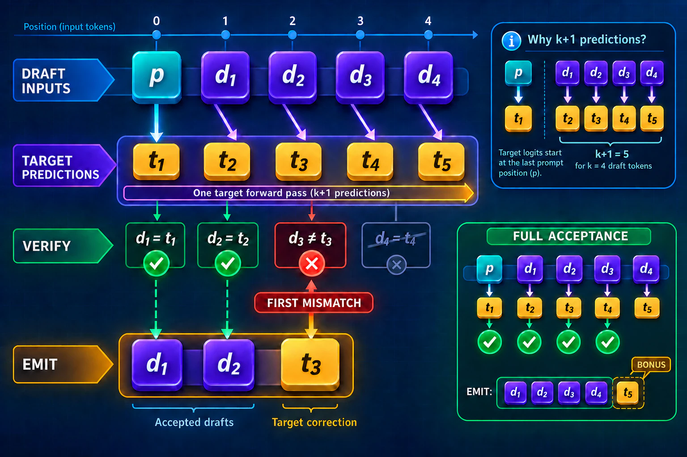
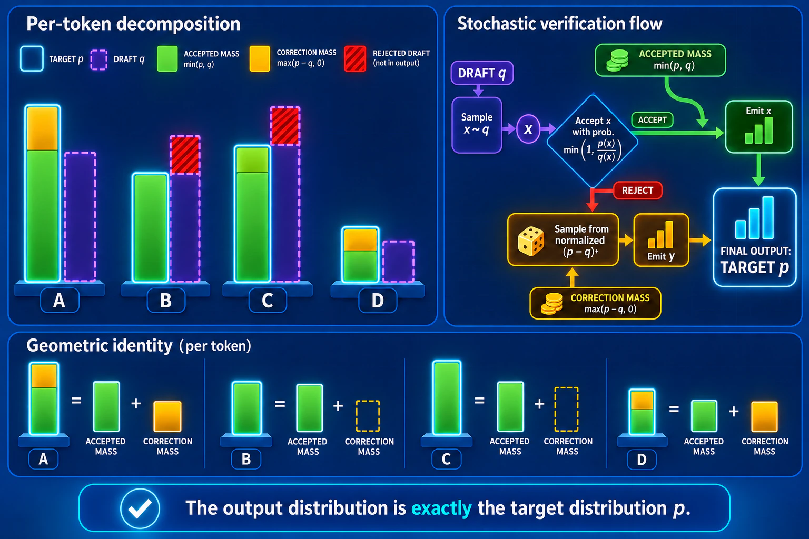

# Beyond — Speculative decoding and multi-token prediction

> **Question this module answers:** *Why does a model that predicts one token at a time not have to generate one token at a time?*


Module 11's generation loop pays one model pass per token because each new token becomes an input to the next. Faster hardware shortens those passes, but it does not remove the dependency between them. Recent releases share a draft-and-verify pattern while putting the drafter in different places. **Reported:** DeepSeek V4's DSpark increases per-user generation speed by 60–85% over an MTP-1 baseline at matched throughput; GLM-5 reaches a 2.76 accept length on a private prompt set with four speculative steps; and Qwen3.8-27B trains with multiple MTP steps. This module builds the load-bearing mechanism — draft, verify in one pass, keep the agreeing prefix — and the safety contract behind it: greedy decoding must reproduce the target's exact greedy sequence, while sampled decoding must preserve the target distribution.

> **This is a Beyond module.** Beyond modules sit outside the numbered course: nothing in Modules 00–20 depends on them, and they are not part of finishing the course. Come here in any order, whenever a model card or paper names the idea and you want the load-bearing version — built, trained, and broken on your own machine.

---
## Before you start

* *Review*
	* [06-language-models](../modules/06-language-models.md) for the fact this module cashes in: one forward pass scores every position in parallel
	* [11-sampling](../modules/11-sampling.md) for the generation loop whose serial cost is the problem
* *Finish*
	* `g2c/transformer` ([09-transformer-block](../modules/09-transformer-block.md))
	* `g2c/sampling` ([11-sampling](../modules/11-sampling.md))
* *Run*
	* `./checkpoints.sh` — the StoryLM reference ladder (1M/5M/30M share `StoryTokenizer`, giving them the compatible token ids this exercise needs)
	* `./datasets.sh --tiny` if the TinyStories corpus is missing (the MTP head trains on it)
	* `G2C_APPLY_SOLUTIONS=01-11 ./notebook.sh specdec` instead of the plain launch if you're entering without your own implementations

---
## Where this fits in

In Module 06 we learned a useful property of autoregression: for a sequence we already know, one forward pass produces next-token logits at every position. Training exploits this to compute a loss at every position in parallel.

Generation is different because the future tokens are not known. Given `n` prompt tokens, we cannot generate token `n+2` until token `n+1` exists. Module 11 therefore pays one serial target pass for each new token.

Speculative decoding supplies guesses for those unknown inputs. A target can score a guessed block with the same teacher-forced parallelism used in training, so one target pass may replace several serial target passes. Think of this as branch prediction for a language model: cheap work proposes a path, authoritative work validates it, and only the valid prefix commits. Verification is not automatically cheaper in wall-clock time — the cost of drafting, scoring the block, and committing state still matters — but it can remove expensive serial target passes.

The StoryLM ladder provides a controlled pairing: the 1M and 5M models are cheap drafters for the 30M target, and all use the same `StoryTokenizer`. A drafter does not generally have to come from the same model family. It does need a compatible token-id mapping and the probabilities required by the verifier's sampling policy.

The economics have several parts: how many draft tokens survive as a prefix, how much the draft costs, how much useful work the target gets from a verification block, and how expensive it is to commit or roll back inference state. A smaller drafter usually lowers proposal cost while also lowering acceptance. The useful question is not simply "how accurate is it?" but "how much verified progress does it buy for the total work?"

## The big idea

The module's greedy speculative decoder runs the following completion loop:

1. Drafter model: generate `k` candidate tokens `d₁ … d_k` from the current completion
2. Target model: score the candidate block in one forward pass, producing aligned predictions `t₁ … t_k` plus `t_{k+1}`
3. Accept the longest prefix `d₁ … d_j` for which every aligned pair `d_i = t_i`
4. Discard the remaining candidate suffix `d_{j+1} … d_k`
5. Emit `t_{j+1}` — the correction at the first mismatch, or the bonus token `t_{k+1}` when all `k` drafts match
6. Repeat loop for the full completion

The overall idea is simple, but there are a few subtleties in that loop that are important to notice.

First, carefully note that there's path dependency in the sequence. The first candidate token that's wrong invalidates all the subsequent tokens, even if they verify. The problem is they're only "correct" for a sequence that we won't be using.

```
            cand:     verify:    match:     action:
token 0:    the       the        correct    emit
token 1:    quick     quick      correct    emit
token 2:    brown     racer      wrong      discard
token 3:    fox       fox        correct    discard (correct on wrong sequence)
```

Second, the forward verification pass will always give us one extra token "for free". If one of the candidate tokens is wrong, then the verification token at that slot is what the target model would generate instead. If all of the candidate tokens are correct, then the forward pass finishes with the final token out of sequence. Either way, we always use this "free token" to emit one additional token at the end. This is what keeps the loop moving forward on the completion, even if the draft model gets zero tokens correct.

```
   drafter (cheap):   proposes  d_1 d_2 d_3 d_4          k serial passes, but cheap
   target (1 pass):   predicts  t_1 t_2 t_3 t_4 t_5      logits at every draft position
                                                          + one past the block
   verify:            d_1 = t_1 ✓   d_2 = t_2 ✓   d_3 ≠ t_3 ✗
   emit:              d_1  d_2  t_3          ← accepted prefix + free correction
```


*The target's logits are shifted by one input position: the last prompt position predicts `t₁`, while the final draft position predicts the free `t₅`. This is the alignment pinned by the module's anchor test.*

### Sampling distribution

An important property of speculative decoding is that it is purely an *inference optimization*. Its presence or the specific drafter model should never change the distribution of output relative to the target model.

Recall that models themselves only produce logits. Actual token output applies a *sampling policy* to those logits. In the previous section we simplified verification to a pairwise comparison of tokens. In actuality there is a specific *verification algorithm* that 1) considers logits of both target and draft models; 2) may be stochastic; and 3) is specific to the target sampling policy. All three levers are necessary, for at least some target sampling policies, to ensure the output distribution is identical. There are two broad classes:

* *Greedy verification* accepts a draft token only where it equals the target's argmax. The emitted sequence is therefore token-for-token identical to plain greedy decoding.

* *Stochastic verification* accepts the next draft token with probability `min(1, p_target / p_draft)`. If rejected, it resamples from the normalized leftover mass of `p_target - p_draft`.


*For each token, accepted mass `min(p,q)` plus correction mass `(p−q)₊` reconstructs the target mass exactly. Draft-only excess is rejected, so the drafter can change work but not the target distribution.*

For greedy verification, induction gives exact sequence equality: every emitted token is the token plain target decoding would emit at that prefix. For stochastic verification, the acceptance and positive-residual correction rule reconstructs the target's next-token distribution at every accepted prefix. The tests empirically check the one-step stochastic result; the primary papers prove the full distribution-preservation theorem.

Be precise about the counters. In this course, `stats.accepted` counts accepted *draft* tokens, `stats.generated` counts all emitted tokens including the correction or bonus, and `tokens_per_pass = generated / target_passes`. A release's reported *accept length* may use a different convention, so it cannot automatically replace `E[accepted] + 1` in the course accounting. Acceptance is important, but it is not the drafter's whole report card: proposal cost, verification cost and wasted block work, batching, concurrency, and state commit determine whether accepted tokens become wall-clock speed.

### Multi-token prediction

Up until now, the drafter has been a separate model. *Multi-token prediction (MTP)* can instead attach future-token prediction modules to the target model's trunk and reuse its representations.

The course builds one deliberately small version. `MTPHead` receives the trunk hidden state `h_t` and the embedding of the known or proposed token `x_{t+1}`, then predicts `x_{t+2}`. It does not receive the trunk's fully updated state `h_{t+1}`. The notebook freezes the pretrained StoryLM base and trains only this post-hoc head so the experiment stays cheap and isolates the mechanism. Production MTP systems may jointly train the trunk and several future-token modules. Predicting farther than this course head can require additional, repeated, or parameter-shared MTP layers; it is not a free change from one output head to arbitrary `N`-token drafting.

At decode time, `mtp_propose` emits the base model's next token and one additional token from the head. Those candidates enter the same verifier used for a separate drafter. In this notebook the proposal and verification are distinct passes, so the timing does **not** realize the near-zero incremental drafting cost available to a production pipeline that carries MTP proposals out of an already-needed trunk pass. The build demonstrates where a drafter can live, not the full serving optimization.

### The accounting

The clean way to assess speculative decoding efficiency is *target passes per token*:

```
   plain:        1 target pass per token
   
   speculative:  1 target pass per (E[accepted drafts] + 1) emitted tokens
                 + k drafter passes per block          (cheap, but not free)
```

The main knob to turn (besides drafter model selection itself) is block size. The longer the block size, the higher the cumulative probability that verification will reject a candidate token. However a shorter block may leave possibly correct draft tokens on the table by ending the sequence too early.

For this single-chain greedy loop, a larger `k` cannot reduce the number of emitted tokens credited to a target pass: the verifier can always stop at the same earlier mismatch. Draft work per round grows roughly linearly with `k`, however, and larger verification blocks may also increase target work and wasted computation after the first rejection. Per-*emitted-token* overhead depends on the measured acceptance distribution rather than growing by a fixed rule. Whether fewer target passes translate into better wall-clock efficiency is an engineering question. In this module, we measure rather than assume.

If one draft pass costs a fraction `c` of one target pass, a simple course cost model is `(E[accepted drafts] + 1) / (1 + k·c)` emitted tokens per target-equivalent unit. It deliberately leaves out verification-block scaling, batching, and state transactions. GLM-5's reported 2.76 accept length is useful evidence about its own private-prompt, four-step setup; without the source's exact counter convention, it is not automatically 2.76 course tokens per target pass.

### Verification is also a state transaction

The losslessness claim has a second half that a token-only implementation can hide. After an iteration, both of these must match ordinary target decoding:

```text
1. emitted tokens
2. committed inference state after those tokens
```

“Match” here means that the state represents the same accepted prefix and produces the same future target outputs, not that every implementation must use the same byte layout. A KV cache and a checkpoint-plus-replay buffer can be semantically equivalent while storing different objects.

For a Transformer KV cache, speculative verification appends `k` candidate rows. If only the first `j` drafts are accepted, rollback can usually move a sequence pointer to the accepted prefix; the rejected K/V rows remain allocated or are overwritten later, but they are no longer visible. The cache is an append-only token history, so every speculative position has an address.

A recurrent layer has a different problem. Its history has already been folded into one state:

```text
S_t = update(S_(t-1), input_t)
```

After applying four draft inputs, `S_(t+4)` does not retain four rows that can be truncated back to `S_(t+2)`. The compression that made state independent of context length also removed cheap undo. Saving a full state snapshot after every draft makes rollback possible, but multiplies traffic for a decode path that is often already memory-bound.

The durable systems pattern is to treat verification like a transaction:

```text
committed checkpoint state S₀ + recent accepted-input buffer
                         │
                         ├─ append k speculative inputs to a branch
                         ├─ compute outputs needed for verification
                         └─ verifier accepts j
                                  │
                    ┌─────────────┴─────────────┐
                    ▼                           ▼
             commit first j inputs      discard rejected suffix
                    │                    by moving a buffer pointer
                    └─ later flush: replay buffered inputs into S₀
```

ReplaySSM is one production realization. It keeps a checkpoint recurrent state and caches recent recurrence inputs rather than materializing and storing a full new state at every token. Outputs can be computed from the checkpoint plus that input buffer; when the buffer fills, replay folds the inputs into a new checkpoint. During speculation, accepting or rejecting a suffix becomes a buffer-pointer operation instead of restoration from `k` full-state snapshots.


*Every strategy commits the same two-token boundary, but the stored object changes the cost of rollback: token rows truncate, compressed state must be restored, and an input log can discard a suffix by pointer before replay.*

This does not change the verifier's probability rule or acceptance length. It changes how the target produces verification outputs and how its hidden state commits the accepted prefix. In a hybrid model, the transaction spans both kinds of state: full/sparse attention layers commit cache rows, while recurrent layers commit buffered inputs or a reconstructed state. Every layer must land on the same accepted token boundary.

The course loop deliberately recomputes the prefix and therefore gets correct state by construction. It does not implement ReplaySSM. The bridge matters because it reveals a hidden denominator in speculative-decoding claims: fewer target passes help only if branching, verifying, and committing the target's actual inference state are cheaper than ordinary decode.

## Concepts to internalize

- **Teacher forcing works on guesses.** One forward pass scores `k+1` positions whether the tokens came from a corpus or a drafter. Verification is Module 06's parallel scoring pointed at the future.
- **Verification is what makes speculation lossless.** Greedy verification preserves the target's exact greedy sequence; stochastic verification preserves its distribution when the acceptance and correction rules match the sampling policy. The drafter may change work, not the target policy.
- **Every iteration advances.** The accepted prefix plus one correction or bonus token guarantees at least one emitted token. Target-pass accounting is therefore no worse than plain decoding, although total compute and wall-clock time can be.
- **Name the acceptance metric.** Accepted drafts, emitted tokens per round, and emitted tokens per target pass are related but not interchangeable. A model-card accept length needs its source convention before it enters your cost equation.
- **MTP can provide an internal drafter.** The course's frozen one-head build proposes only one extra future token; production systems may jointly train multiple or shared MTP layers and integrate proposal work into serving.
- **Drafter and target need compatible token ids and sampling information.** Sharing a tokenizer is the straightforward case. A mismatched vocabulary without an explicit mapping makes draft ids meaningless to the target.
- **Losslessness includes state.** After each block, the emitted tokens *and* every target-layer cache or recurrent state must match target-only decoding at the accepted boundary.
- **Rollback depends on the state representation.** A KV cache can truncate token rows; a fixed recurrent summary has no intrinsic undo. Snapshotting, replaying inputs, or reconstructing state are different systems costs around the same verifier.
- **Replay turns recent inputs into a transaction log.** A stable checkpoint plus an input buffer separates speculative work from committed history; commit and rejection can become pointer changes rather than full-state copies.

### What we don't cover

- **Tree and multi-candidate drafting.** Medusa and EAGLE verify a *tree* of candidate continuations in one pass with specialized attention masks. Our single-chain block is the mechanism; trees are its batched generalization.
- **Cached-state integration and ReplaySSM kernels.** Production verification reuses and commits KV caches, recurrent states, or replay buffers across iterations. Our loop recomputes the prefix so the algorithm stays inspectable; Module 16 has the cache this would compose with, while [Beyond Linear Attention](linear-attention.md) supplies the fixed-state recurrence whose rollback is different.
- **Hardware-aware speculation scheduling.** DSpark chooses draft lengths against measured server throughput. That is a serving-systems concern layered on top of the mechanism built here.
- **The full sampled speculative loop.** We build and verify the stochastic acceptance *rule*; the notebook's decoding loop is greedy, where losslessness is checkable by string equality rather than statistics.
- **Distribution-preservation proofs.** The tests empirically check the one-step theorem; the two primary papers supply the mathematical proof.

---
## What you'll build

Package: `g2c/specdec/`

```python
# verify.py — pure functions, the module's core
def greedy_verify(draft_ids, target_logits): ...        # SCAFFOLDED
    # accepted-prefix length + the target's free correction/bonus token
def speculative_verify(draft_ids, target_probs,
                       draft_probs, *, generator): ...  # SCAFFOLDED
    # the min(1, p_t/p_d) acceptance rule + residual resampling

# generate.py — the loop and its instrument
class SpecStats: ...                                    # implemented
    # target_passes, drafted, accepted, generated;
    # acceptance_rate, tokens_per_pass
def draft_greedy(drafter, ctx_ids, k): ...              # implemented
def speculative_generate(target, drafter, prompt_ids,
                         max_new_tokens, *, k, eos_id): ...  # SCAFFOLDED

# mtp.py — the model drafts for itself
def hidden_states(model, token_ids): ...                # implemented
class MTPHead(Module):                                  # boilerplate implemented
    def forward(self, hidden, next_token_ids): ...      # SCAFFOLDED
def mtp_loss(mtp_logits, token_ids): ...                # SCAFFOLDED
def mtp_propose(base, head, ctx_ids): ...               # implemented
```

`MTPHead` freezes its base the same way Module 13B's `LoRAModel` does — by leaving it out of `parameters()` — so Module 03B's optimizer trains the head and nothing else.

## How to run the tests

Tests live in `tests/test_specdec.py`. Initial state: 5 passed (the stats instrument, provided drafting, and the head's freeze-by-omission), 15 failed. The verification and loop tests run against tiny deterministic table-lookup mock models, so they need no trained checkpoint; the two integration tests at the bottom drive real `TransformerLM`s and additionally need Modules 05–09.

```bash
source .venv/bin/activate

pytest tests/test_specdec.py              # all module tests
pytest tests/test_specdec.py -x           # stop at first failure (recommended)
pytest tests/test_specdec.py -k verify    # the two verification rules
pytest tests/test_specdec.py -k generate  # the speculative loop
pytest tests/test_specdec.py -k mtp       # the MTP head
```

The anchor test: `test_speculative_generate_matches_argmax_chain_with_any_drafter` pairs the target with a completely unrelated drafter and asserts the output still equals the target's own greedy chain. Nearly every bug — the off-by-one in the verification block's logits, a forgotten correction token, accepting one token too many — breaks that equality immediately.

## Exercises

Open the working notebook with `./notebook.sh specdec` (or `./notebook.sh specdec --fresh` to archive the current copy and reset from the clean scaffold), write your answers in the `Question:` / `Answer:` cells, and ask a coding agent for hints or grading. Partial submissions are fine because blank answers are skipped.

1. **Prove losslessness on the real ladder.** StoryLM-1M drafts for StoryLM-30M; assert the speculative output is byte-identical to plain greedy decoding across several prompts, then read the `SpecStats`.
2. **Sweep the acceptance curve.** Tokens-per-pass across `k ∈ {1, 2, 4, 8}` for both drafters (1M and 5M). Where does a bigger block stop paying, and which drafter earns its extra cost?
3. **The wall-clock honesty benchmark.** Time plain versus speculative decoding at your best configuration, with MPS synchronization. Report tokens/sec next to tokens/pass, including "the accounting improved and the clock didn't," if that is what you measure.
4. **Train the MTP head.** Bolt `MTPHead` onto frozen StoryLM-5M, train it on TinyStories, and plot the two-ahead loss and top-1 accuracy. Compare it with the base model's one-ahead accuracy without assuming which must be higher; use the information available to each predictor to interpret what you observe.
5. **Self-speculation.** Decode with `mtp_propose` + `greedy_verify` (a five-line loop) and compare its acceptance and tokens-per-pass against the separate-drafter runs from Exercise 2.
6. **Written: the cost model.** With drafter/target cost ratio `c` and measured accepted drafts, derive emitted tokens per unit of target-equivalent compute for your best run and state the break-even acceptance for `k = 4`. Then compare the course metric carefully with GLM-5's reported 2.76 accept length, naming what you would need to know before equating them.

## Pitfalls to expect

- **The verification block's off-by-one.** The `(k+1)` logits rows start at the position *predicting* the first draft token — one before the draft begins. Slicing the last `k` rows instead of the last `k+1` silently verifies against shifted predictions; the anchor equality test fails immediately and the error reads as "everything gets rejected."
- **Forgetting the free token.** On full acceptance the bonus row is a real emission; on rejection the correction is. Drop either and the loop can stall at zero progress or emit one-short blocks that break the equality.
- **Comparing across different context crops.** Plain `generate` crops to `max_seq_len`; the speculative loop must leave room for the draft block. Inside the window the outputs match exactly; if your equality check strays near the window edge, the divergence is crop semantics, not a bug.
- **Timing MPS without synchronization.** The Python timer stops before Metal finishes. Synchronize around every measured region, and report medians of repeats.
- **Expecting wall-clock to follow tokens-per-pass at toy scale.** Our verification recomputes the full prefix and the drafter loops in Python. The accounting win is real and measured; the latency win depends on machinery (KV cache, batching) this module deliberately doesn't build.
- **The MTP shift-by-one.** Misalign `mtp_loss` and the head cheerfully learns to predict `x_{t+1}` — a job the base already does perfectly — and every draft it proposes later gets rejected. The alignment test pins the correct shift; trust it over your intuition.
- **Tokenizer mismatch.** A drafter with an incompatible token-id mapping produces ids the target reads as arbitrary symbols. Acceptance near zero with no error message is the symptom; model-family membership itself is not the requirement.

## M-series notes

- **Checkpoint downloads:** the ladder is ~5MB (1M), ~22MB (5M), and ~117MB (30M). All three load comfortably on any course-spec machine.
- **Verification passes recompute the whole prefix,** so per-pass cost grows with context. Keep benchmark prompts modest (a few hundred tokens) and growth stays invisible; this module's numbers are about pass *counts*.
- **The MTP training block is the compute cost of the module** — a few hundred head-only steps on TinyStories, minutes on MPS. Plug in for it. Everything else runs in seconds.
- **Timing cells synchronize MPS** before and after each measured region; keep that pattern if you add measurements of your own.

---
## Reading

Primary:

- **Leviathan, Kalman, Matias, ["Fast Inference from Transformers via Speculative Decoding"](https://arxiv.org/abs/2211.17192) (2022).** The draft-and-verify loop and the acceptance rule — this module is this paper, built. Read it first.
- **Chen, Borgeaud, Irving, Lespiau, Sifre, Jumper, ["Accelerating Large Language Model Decoding with Speculative Sampling"](https://arxiv.org/abs/2302.01318) (2023).** Independent derivation of the same rule, with the cleanest one-page proof that the target distribution survives.
- **Gloeckle, Idrissi, Rozière, Lopez-Paz, Synnaeve, ["Better & Faster Large Language Models via Multi-token Prediction"](https://arxiv.org/abs/2404.19737) (2024).** MTP as a *training* objective, before it became a serving feature.

Secondary:

- **[DeepSeek-V3 Technical Report](https://arxiv.org/abs/2412.19437) (2024), the MTP section.** A shared-trunk sequential MTP design related to this module's much smaller post-hoc head. Do not flatten the production objective into the course implementation.
- **Cai et al., ["Medusa"](https://arxiv.org/abs/2401.10774) (2024)** and **Li et al., ["EAGLE"](https://arxiv.org/abs/2401.15077) (2024).** Multiple heads, tree-structured drafts, and feature-level drafting — generalizations beyond a single chain.
- **Dao AI Lab, ["ReplaySSM: Cache SSM Inputs, Not State"](https://dao-lab.ai/blog/2026/replayssm/) (2026).** The state-transaction bridge for recurrent and delta-rule targets: checkpoint state, buffered recurrence inputs, cheap suffix rollback, and output-only speculative verification. Read for the systems contract; this module does not build its kernels.

Optional:

- **The current release lineage.** [DeepSeek V4's DSpark report](https://arxiv.org/abs/2607.05147), [GLM-5's parameter-shared MTP report](https://arxiv.org/abs/2602.15763), and the [Qwen3.8-27B model card](https://huggingface.co/Qwen/Qwen3.8-27B) show different places and training schemes for a drafter. [GLM-5.3-Flash](https://z.ai/blog/glm-5.3-flash) adds ReplaySSM to the serving side. After this module, read each system in terms of its drafter, verifier, stated metric convention, and state-commit path — not just its headline speedup.

## Deliverable checklist

- [ ] All tests in `tests/test_specdec.py` pass — the any-drafter equality anchor especially.
- [ ] Notebook: losslessness demonstrated on the StoryLM ladder (Exercise 1), the acceptance sweep (Exercise 2), and the honest wall-clock benchmark (Exercise 3).
- [ ] The MTP head trained, and self-speculation measured against separate-drafter speculation (Exercises 4–5).
- [ ] Written answer for the cost model (Exercise 6).
- [ ] You can explain — out loud, without notes — why greedy speculative decoding cannot change the output, only the pass count.
- [ ] You can explain — out loud, without notes — what the stochastic acceptance rule guarantees, and what the drafter can and cannot influence.
- [ ] You can explain — out loud, without notes — why tokens-per-pass and wall-clock speedup are different claims.
- [ ] You can explain — out loud, without notes — what an MTP head changes about where the drafter lives, and why separate models need compatible token ids and sampling information.
- [ ] You can explain — out loud, without notes — why token equality is insufficient if rejected drafts remain folded into target state.
- [ ] You can contrast KV-cache truncation, per-draft recurrent-state snapshots, and checkpoint-plus-input replay as three ways to commit the accepted prefix.
