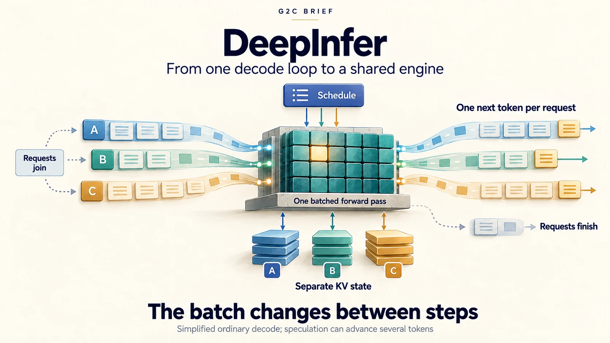
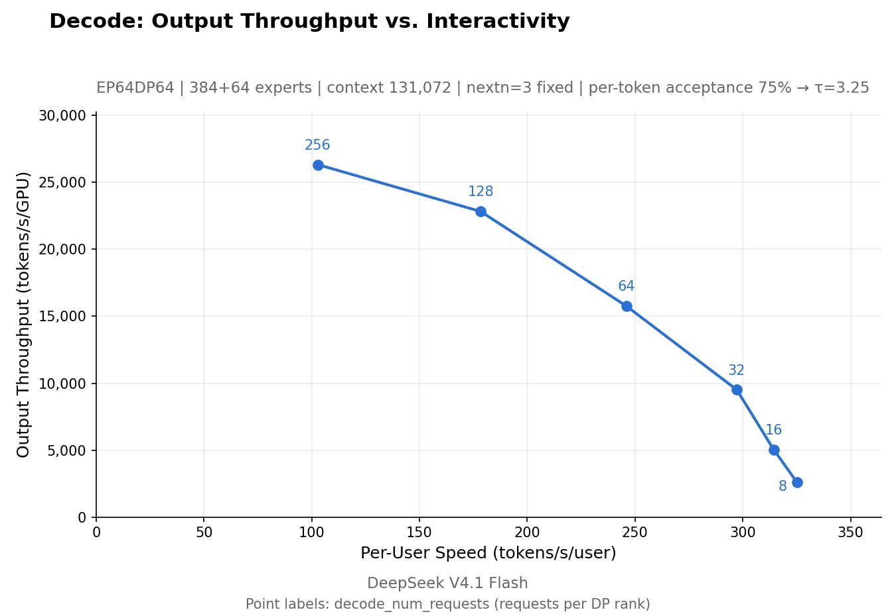
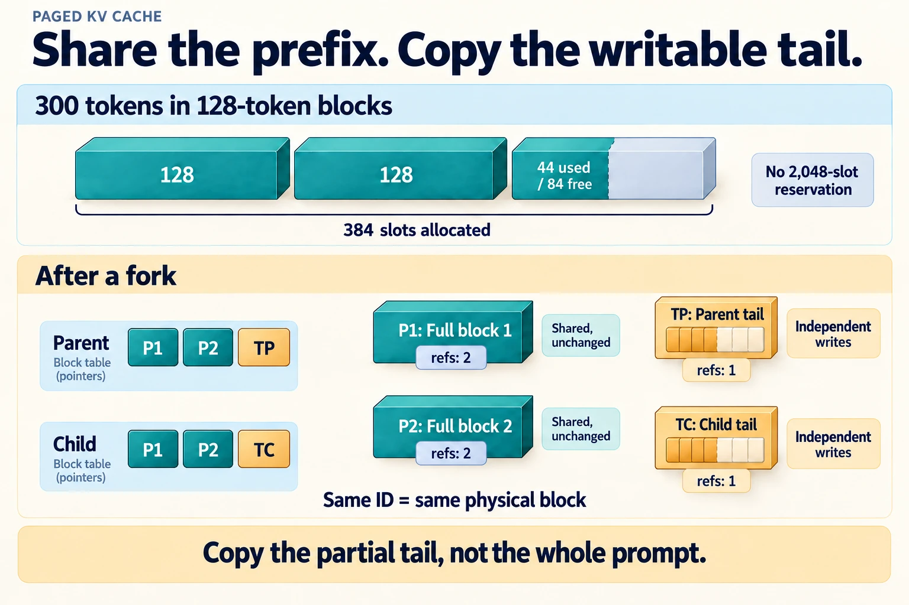
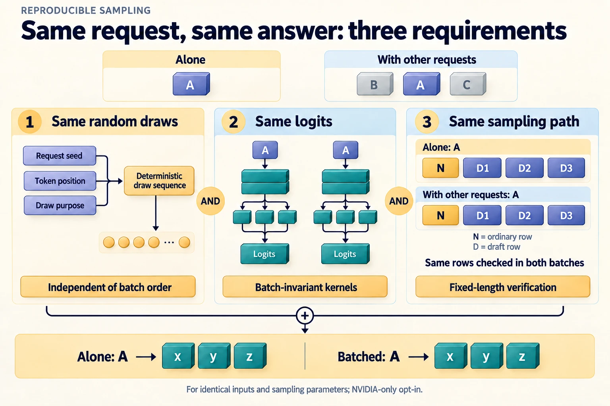

# G2C Brief — DeepInfer: reading a production inference engine

> **Question this Brief answers:** *What happens to a language model between its weights and a million users, and how much of it did you already build?*



On October 20, 2026, DeepSeek open-sourced
[DeepInfer](https://github.com/deepseek-ai/DeepInfer), the inference framework
behind its production DeepSeek V4.1-Flash service. Alongside the code it
published a long
[deployment Q&A](https://github.com/deepseek-ai/DeepInfer/blob/774ce244b87cc0eb8d4b94ab9f5de2ab22049f01/doc/inference_deployment_qa.md)
and a companion library,
[deepseek-recipe](https://github.com/deepseek-ai/deepseek-recipe), that turns
API requests into tokens and back. The Q&A says a single cluster serves 155
trillion tokens a day.

The release reverses an earlier decision. In April 2025 DeepSeek
[explained](https://github.com/deepseek-ai/open-infra-index/blob/main/OpenSourcing_DeepSeek_Inference_Engine/README.md)
why it would *not* open-source its engine: it was an old, heavily customized
vLLM fork, tightly coupled to internal infrastructure, and the team lacked
bandwidth to maintain it. DeepInfer's README still credits vLLM as its
starting point, and the release still holds back the most infrastructure-bound
parts, but the engine itself is now public.

An inference engine sounds like pure systems engineering, and much of
DeepInfer is. This Brief is not a tour of the repository. It reads DeepInfer
for the places where something you built in g2c shows up again at production
scale and has to change to survive there:

1. The decode loop from [Module 11](../modules/11-sampling.md) and
   [Module 16](../modules/16-inference.md), rewritten to serve a batch instead
   of one sequence.
2. Module 16's KV cache, turned into a memory system with pages, sharing, and
   storage tiers.
3. Module 11's sampler, made reproducible when thousands of requests share a
   GPU.
4. Speculative decoding from [Beyond: speculative decoding](../beyond/specdec.md),
   with a verification budget chosen by expected value.
5. The grammar mask from [Module 18](../modules/18-tools.md) and the special
   tokens from [Module 04](../modules/04-tokenizer.md), at the boundary where
   untrusted text becomes tokens.

The model itself is covered in the
[DeepSeek V4.1-Flash Brief](deepseek-v4.1-flash.md). You don't need it to read
this one, and this Brief does not re-explain the architecture.

---

## Snapshot

| | |
|---|---|
| **Subject** | DeepInfer, DeepSeek's production inference framework, plus the deployment Q&A published with it |
| **Primary sources** | [DeepInfer repository](https://github.com/deepseek-ai/DeepInfer) (Apache 2.0) at commit `774ce24`; its [README](https://github.com/deepseek-ai/DeepInfer/blob/774ce244b87cc0eb8d4b94ab9f5de2ab22049f01/README.md) and [deployment Q&A](https://github.com/deepseek-ai/DeepInfer/blob/774ce244b87cc0eb8d4b94ab9f5de2ab22049f01/doc/inference_deployment_qa.md); [deepseek-recipe](https://github.com/deepseek-ai/deepseek-recipe) (MIT) |
| **Supported model** | [DeepSeek-V4.1-Flash-1017](https://huggingface.co/deepseek-ai/DeepSeek-V4.1-Flash-1017) only |
| **Supported hardware** | NVIDIA SM100 GPUs and Huawei Ascend 950 NPUs. The smallest efficient deployment the Q&A describes is 64 GPUs for prefill plus 64 for decode. |
| **What is released** | Offline (batch) inference: kernels, model runtime, scheduler, sampler, speculative decoding, structured outputs |
| **What is not released** | The KV cache storage system, the load balancers, and the plumbing that separates prefill, decode, and vision encoding onto different machines. The Q&A describes these; a [Zhihu blog post](https://zhuanlan.zhihu.com/p/2095560295930508953) (in Chinese) covers them in more depth. |
| **Size** | About 55,000 lines of Python plus a C++ scheduler and engine core (**Derived**, counted from the checkout) |
| **Last verified** | October 20, 2026, against commit `774ce24` |

The labels follow the [standard Brief meanings](index.md), with one note
specific to a code release:

- **Reported:** a claim from DeepSeek's README or Q&A. Every performance and
  business number in this Brief is self-reported. Nobody has independently
  reproduced them yet, and doing so needs the hardware above.
- **Derived:** either arithmetic from disclosed values, or a statement read
  directly from the released code. A file link is given in either case.
- **G2C interpretation:** the course's reading of why a design choice was
  made, when the source doesn't say.
- **Not disclosed:** details the release does not include.

---

## The change of perspective: from one sequence to a batch

Here is the generation loop you wrote. It is `generate_cached` from Module 16,
reduced to its skeleton:

```text
cache = empty
for token in prompt:                     # the prompt, one token at a time
    logits, cache = model.forward_cached(token, cache)
for step in range(max_new_tokens):
    next_id = sample(logits)             # Module 11's warpers, then multinomial
    if next_id == eos: break
    logits, cache = model.forward_cached(next_id, cache)
```

It serves one user, and everything in it belongs to that user: the cache, the
random generator, and the GPU. A serving engine runs a different loop. Every
**step** advances *every* active request by one token (or several, with
speculation), and requests join and leave between steps:

```text
             ┌──────────────────── one engine step ─────────────────────┐
  waiting ──►│ schedule:  which requests run, how many tokens each,      │
  requests   │            where their cache blocks live                 │
             │ forward:   one batched pass over all of them              │──► finished
             │ sample:    one token (or a verified prefix) per request   │    requests
             │ process:   append tokens, check stop conditions, stream   │
             └──────────────────────────────────────────────────────────┘
```

This is often called **continuous batching**. DeepInfer's scheduler
([`csrc/engine/scheduler.hpp`](https://github.com/deepseek-ai/DeepInfer/blob/774ce244b87cc0eb8d4b94ab9f5de2ab22049f01/csrc/engine/scheduler.hpp))
is about 1,300 lines of C++ that answer the first box's question every step.

**G2C interpretation.** Almost every change in this Brief follows from that
one shift. Once many users share a forward pass:

- the cache has to be managed like memory, because thousands of caches of
  different lengths compete for the same GPU;
- sampling has to be reproducible without a private random generator per user;
- speculative decoding has to budget verification work across everyone in the
  batch;
- and the CPU work around each step has to be hidden, because the GPU now
  waits for *everyone's* bookkeeping.

The rest of the Brief takes these one at a time.

---

## 1. Prefill and decode are different jobs

[Module 16](../modules/16-inference.md#prefill-and-decode) splits a request
into **prefill**, one parallel pass over the whole prompt, and **decode**, one
token per step. Prefill reuses each weight it reads across every prompt token,
so it is limited by arithmetic. Decode streams every weight again for a single
token, so it is limited by memory bandwidth. On a laptop you measured that gap
for one request: ProdLM's prefill and decode rates, and your own model's
one-pass prefill against `generate_cached`'s token-by-token loop.

A server adds the other dimension: many requests at once. DeepInfer's two
published benchmark charts show what happens to each phase as the batch grows.


*Prefill saturates early. **Reported:** DeepInfer's prefill benchmark on 4 SM100 GPUs at 131K context (chart from the DeepInfer repository, Apache 2.0). **Derived (read off the chart):** 16× more tokens per step buys only about 1.5× more throughput, at about 11× the latency.*


*Decode is a trade between throughput and each user's speed. **Reported:** DeepInfer's decode benchmark on 64 SM100 GPUs at 131K context (chart from the DeepInfer repository, Apache 2.0). The chart's token counts depend on an assumed speculative acceptance rate, discussed under [Reading the numbers](#reading-the-numbers).*

**Derived (read off the charts, so approximate).** Divide per-user speed by
the chart's stated tokens per step (3.25) to get engine steps per second, then
invert to get step time:

| Requests per GPU | Per-user speed | Step time | Throughput per GPU |
|---:|---:|---:|---:|
| 8 | ~325 tok/s | ~10.0 ms | ~2,600 tok/s |
| 64 | ~246 tok/s | ~13.2 ms | ~15,700 tok/s |
| 256 | ~103 tok/s | ~31.6 ms | ~26,300 tok/s |

Going from 8 to 64 requests makes each step only about a third slower, so
throughput rises about 6×. That is what "memory-bound" means in practice: the
weights have to be read once per step whether one request uses them or 64
do, so extra requests are almost free until the arithmetic finally catches
up. Prefill has no such headroom. Its arithmetic is already the bottleneck at
a few thousand tokens.

**Reported.** DeepSeek takes this all the way to separate machines. Prefill
runs on ordinary 8-GPU servers with 2–8-way parallelism. Decode runs on 64–128
GPU "supernodes" with as much parallelism as possible ("Wide-EP"), because
the more GPUs share the expert weights, the less each GPU has to stream per
step. A request is prefilled on one machine, and its cache is shipped to a
decode machine to continue.

Prefill also has to be sliced. A 200,000-token prompt can't monopolize a GPU
while other requests wait, so the scheduler runs **chunked prefill**: a long
prompt is processed in pieces, at most `max_num_batched_tokens` per step
(**Derived**, from the scheduler). **Reported.** In production each prefill
step gets a time budget. A fitted quadratic cost model, `cost(q, c)`,
predicts how long a chunk of `q` new tokens takes on top of `c` already-cached
tokens, and the scheduler solves for the largest chunk that fits. It is
quadratic because attention work grows with both the chunk and the prefix it
attends to, which is the `T²` from Module 07 coming back as a scheduling
constraint.

---

## 2. The KV cache becomes a memory system

Your Module 16 cache is one growing tensor per layer, extended by
concatenation each step. For one user that's the right design. A server can't
do it. Concatenating thousands of caches of different lengths means constant
reallocation and fragmented GPU memory. The alternative of reserving
`max_seq_len` for every request wastes most of the reservation. Module 16's
own example makes the point: a 7B model reserving 2,048 positions holds
1.07 GB per request, whether the request uses 2,048 tokens or 50.

### Pages, reference counts, and copy-on-write

DeepInfer does what operating systems do with RAM. GPU cache memory is cut
into fixed-size **blocks** (128 tokens for V4.1-Flash), and each request keeps
a **block table** listing the blocks that hold its cache, in order. The
block manager
([`csrc/engine/block_manager.hpp`](https://github.com/deepseek-ai/DeepInfer/blob/774ce244b87cc0eb8d4b94ab9f5de2ab22049f01/csrc/engine/block_manager.hpp))
is about 240 lines: a free list, plus a reference count on every block
(**Derived**, from the code).

**Derived.** A 300-token request in a 2,048-slot reservation uses 15% of it.
In 128-token blocks it holds three blocks (384 slots) and uses 78% of them.
The waste per request is now under one block, regardless of `max_seq_len`.

Reference counts make sharing cheap. When the engine **forks** a sequence (to
draw several samples from one prompt, say), the child's block table points at
the parent's blocks, and each shared block's count goes up. Only the last,
partly-filled block is copied, because both sequences are about to write into
it. A scheduler comment (in Chinese) describes it as the last, "possibly
half-written" block (**Derived**, from
[`scheduler.hpp`](https://github.com/deepseek-ai/DeepInfer/blob/774ce244b87cc0eb8d4b94ab9f5de2ab22049f01/csrc/engine/scheduler.hpp)).
That's copy-on-write.

**G2C interpretation.** This is how a server makes Module 11's best-of-N
affordable. DeepInfer's own evaluation scripts draw 32 samples per AIME
problem. With forks, the prompt's cache is computed and stored once and shared
32 ways, not 32 times.


*Paging makes two savings visible. **Derived:** a block table orders a request's cache without requiring contiguous storage; after a fork, both tables point to the same full prefix blocks. Only the partial tail is copied for independent writes. The 300-token example counts token slots, not bytes.*

### A cache that outlives the request

**Reported.** DeepSeek keeps caches long after a request ends, so that the
next turn of a conversation, or the next step of an agent, can skip
prefilling the shared prefix. One of the system's three stated design goals is
to retain KV cache for more than 72 hours. The tiers:

| What | Where | Lifetime |
|---|---|---|
| Live requests' cache blocks | GPU memory | while the request runs |
| Sliding-window (local attention) state | host memory on the machine that produced it | short; looked up through an in-memory directory |
| Global cache blocks | a dedicated SSD cluster (3FS, ~100 PiB) | 3 days for agent traffic, 7 for chat, reclaimed least-recently-used |

**Reported.** A returning request finds its cached prefix by matching a chain
of block hashes. The match happens before routing, so any prefill machine can
use any cached prefix. Chat traffic gets the longer lifetime because a small
amount of its cache is reread very many times; DeepSeek measured that a
3-day lifetime would cost chat 0.5–1% of its cache hit rate.

The hit rule shows how the tiers interact. **Reported:** for an input of
length `L`, at most `L − 134` tokens can come from cache (a 128-token window
plus 6 tokens of slack for speculative decoding). The global blocks set the
hit length. If the matching sliding-window state is missing, the server
backs off one block and replays the last 128 tokens of the hit to rebuild it.

**Derived (simplified, from the reported rule).** An agent returns with a
10,000-token context. The cap is 9,866 tokens, which rounds down to 77 full
blocks, or 9,856 tokens.

- If the window state is still in host memory, the server reuses 9,856 tokens
  and computes 144.
- If it was evicted, the server reuses 9,728 and computes about 400: 128
  replayed plus 272 new.
- With no cache at all, it computes 10,000.

**Derived.** The window state that gets stored is a fixed size per sequence:
20 layers × 134 tokens × 528 bytes = 1,415,040 bytes, about 1.35 MiB however
long the conversation. The global cache grows with length instead: at
V4.1-Flash's reported 890 bytes per token, a 100,000-token context is about
89 MB.

The replay is approximate. Rebuilding the window from only 128 tokens gives
back state that is close to, but not exactly, what the model originally
computed. The [V4.1-Flash Brief](deepseek-v4.1-flash.md#bounded-replay-what-to-throw-away-between-turns)
covers why that's acceptable and what it costs. For this Brief the point is
narrower: Module 16 taught the cache as an *exact* memo, and a production
cache is an exact memo only some of the time.

---

## 3. Sampling, reproducibly, in a crowd

Module 11's sampler is a pipeline: temperature, top-k, top-p, softmax,
`torch.multinomial`. DeepInfer runs the same pipeline, fused into one GPU kernel
per batch
([`fused_sample.py`](https://github.com/deepseek-ai/DeepInfer/blob/774ce244b87cc0eb8d4b94ab9f5de2ab22049f01/deepinfer/model_executor/layers/tilelang_ops/cuda/fused_sample.py)).
The interesting changes are about reproducibility.

### Whose random numbers?

Your `generate` takes one `torch.Generator`, and with one sequence that's
enough for reproducibility. Put 64 requests through one generator and it
breaks: each request's draw depends on where it sits in the batch and on who
else is there. The same request with the same seed can produce a different
answer because a stranger's request arrived first.

**Derived, from the code.** DeepInfer gives every request its own 64-bit
`seq_seed`
([`sampling_params.py`](https://github.com/deepseek-ai/DeepInfer/blob/774ce244b87cc0eb8d4b94ab9f5de2ab22049f01/deepinfer/sampling_params.py)).
The kernel then initializes a **counter-based** random generator from that
seed and the token's position (`rng_init(seed, position × 3 + k)`). The
offset `k` separates the three different uses of randomness at one position:
0 for an ordinary sample, 1 for a resample after a rejected draft, and 2 for
the accept-or-reject coin flip. A request's random numbers therefore depend
only on *its own* seed and position. Batch order and batch-mates no longer
matter.

The repository tests exactly that property. It samples a batch, shuffles the
rows and samples again, then samples every row alone, and asserts the tokens
are identical each time (`test_random_sampling_batch_invariant` in
[`random_sampling.py`](https://github.com/deepseek-ai/DeepInfer/blob/774ce244b87cc0eb8d4b94ab9f5de2ab22049f01/deepinfer/model_executor/layers/tilelang_ops/random_sampling.py)).

**Derived, from the code.** Two smaller details in the same kernel:

- The cumulative probabilities are summed in **fixed-point integers**, not
  floats, and the random target is drawn with rejection to avoid modulo bias.
  The docstring says this guarantees "a monotone fixed-point CDF." **G2C
  interpretation:** integer addition is associative, so the sampled token
  can't depend on the order in which threads add up probabilities. The next
  subsection explains why that matters.
- `temperature = 0` is not special-cased as `argmax`. It is clamped to
  `1e-5` and goes down the sampling path, which for practical purposes always
  picks the top token. Your `generate_cached` branches to `argmax` instead.
  Both are reasonable; only one keeps a single code path.

### Batch invariance: the floating-point problem

A per-request seed fixes the randomness. It does not fix the *logits*, and
here a fact the course has been quietly working around comes forward:
**floating-point addition is not associative.** In Python,
`(0.1 + 0.2) + 0.3 == 0.1 + (0.2 + 0.3)` is `False`. A matrix multiply or an
attention reduction sums many products. A GPU kernel picks how to split that
sum across threads based on the *shapes* involved, including the batch size.
Change the batch and the summation order changes, so the last bits of the
logits change. Usually that's harmless. Occasionally it flips which token
crosses a top-p threshold, or which way a near-tie goes, and from then on two
runs of "the same" request diverge.

You have already met this. Module 16's test checks that your cached path
matches the full forward pass with `torch.allclose(cached, full, atol=1e-5)`,
not `torch.equal`. The two paths do the same math in a different order, so
they agree to five decimal places and not bit for bit.

**Reported.** DeepInfer offers **batch-invariant inference**
(`DEEPINFER_BATCH_INVARIANT=1`, NVIDIA only): a request's logits come out
bit-identical regardless of what else is in the batch. **Derived, from the
code.** The switch puts DeepSeek's GEMM and kernel libraries into
deterministic mode and turns off a fused kernel path in some attention
layers. When experts are being reassigned between GPUs, it also restricts
how the expert-parallel communication layer combines partial results. Its
test generates 64 prompts as a batch, replays each one alone along the same
tokens, and requires the tokens, log probabilities, and top-5 lists to match
exactly.

**Reported.** Fully *deterministic sampling* needs three things together:
batch invariance, a fixed `seq_seed`, and fixed-length speculative
verification (`DEEPINFER_ENABLE_MTP_VARLEN=0`). The next section explains
the third requirement.


*The seed controls only one source of variation. **Reported:** DeepInfer's deterministic-sampling mode requires all three conditions together. **G2C interpretation:** think of them as three separate contracts—random draws, numerical results, and sampling path. Section 4 explains why a shared verification budget breaks the third.*

**Not disclosed:** how much throughput batch invariance costs. The README
doesn't say, and it isn't on by default.

**G2C interpretation.** Why build this at all? Debugging, mostly. When a user
reports a bad answer, you want to replay it and get the same answer. When you
change a kernel, you want to tell real regressions from reordering noise.
DeepInfer's test suite compares perplexity baselines "exactly, sample by
sample," which only works if the numbers are reproducible. Batch invariance
also matters for reinforcement learning: if the rollout engine and the
trainer compute different probabilities for the same tokens, the policy
gradient is quietly off.

---

## 4. Speculative decoding with a budget

[Beyond: speculative decoding](../beyond/specdec.md) builds the core
mechanism: a cheap drafter proposes several tokens, the target model scores
them all in one pass, and stochastic verification accepts each draft with
probability `min(1, p_target / p_draft)`, resampling from the leftover mass
`max(p_target − p_draft, 0)` at the first rejection.

**Derived, from the code.** DeepInfer's sampler implements that same rule.
The kernel computes `accept_lp = min(target_lp − draft_lp, 0)`, accepts when a
uniform draw falls below `exp(accept_lp)`, and on rejection samples from
`max(p_target − p_draft, 0)`. One small deviation: the draft probability in
the residual is shrunk by a factor of `exp(−5×10⁻⁵)`, with a comment saying
this keeps "reject sampling" from coming up empty. **G2C interpretation:**
that is a numerical guard. It moves the output distribution away from exact
by an amount far below what any evaluation could detect, but strictly
speaking it isn't zero.

The drafter is DSpark, which drafts up to five tokens. The V4.1-Flash Brief
covers how it was trained. What's new here is the **verification budget**.

### Not every draft is worth checking

Verification isn't free. Every draft token you verify is another row in the
target model's forward pass. With fixed-length verification, every request
pays for five draft rows every step, even when the drafter is guessing. A
confidence head on the drafter predicts how likely each draft token is to be
accepted, and the scheduler spends verification only where the expected
return is highest.

**Derived, from the code**
([`csrc/engine/mtp_varlen.hpp`](https://github.com/deepseek-ai/DeepInfer/blob/774ce244b87cc0eb8d4b94ab9f5de2ab22049f01/csrc/engine/mtp_varlen.hpp)
and
[`schedule_mtp_varlen.py`](https://github.com/deepseek-ai/DeepInfer/blob/774ce244b87cc0eb8d4b94ab9f5de2ab22049f01/deepinfer/model_executor/layers/tilelang_ops/schedule_mtp_varlen.py)).
The planner works in four steps:

1. A draft token is only useful if *every* draft before it is also accepted,
   so its chance of mattering is the running product of the confidences:
   `P(draft i survives) = c₁ × c₂ × … × cᵢ`.
2. Pool every (request, draft position) pair in the batch and sort by that
   product.
3. Every request always gets one row for its ordinary next token. Then add
   draft rows in sorted order. At each total, divide the expected tokens
   produced by the predicted step time. The step time comes from a profiled
   curve, corrected online with running medians of measured step times.
4. Keep the total with the best expected throughput.

A toy version with invented numbers shows the shape of the decision. Two
requests share a step. Request A's drafter is confident (0.9 per token) and
B's is not (0.5). Suppose a step takes 10 ms for up to 4 rows, 13 ms for up
to 6, and 16 ms for up to 8.

| Rows | Rows added | Expected tokens | Step time | Tokens per ms |
|---:|---|---:|---:|---:|
| 2 | one ordinary row each | 2.00 | 10 ms | 0.200 |
| 3 | A's draft 1 (0.9) | 2.90 | 10 ms | 0.290 |
| 4 | A's draft 2 (0.81) | 3.71 | 10 ms | 0.371 |
| 5 | A's draft 3 (0.729) | 4.44 | 13 ms | 0.342 |
| **6** | **B's draft 1 (0.5)** | **4.94** | **13 ms** | **0.380** |
| 7 | B's draft 2 (0.25) | 5.19 | 16 ms | 0.324 |
| 8 | B's draft 3 (0.125) | 5.31 | 16 ms | 0.332 |

**Derived.** The planner verifies 6 rows: A gets all three drafts, B gets one.
Fixed-length verification of all eight rows would produce 5.31 tokens in
16 ms (0.332 per ms), about 13% less.


*Read the probabilities as prefixes: A's third draft matters only if all three survive. **Derived from the invented example above:** the best budget checks four draft rows plus two ordinary rows. It produces fewer expected tokens per step than checking everything, but more per unit time. The cutoff comes from evaluating candidate budgets against step time; these are teaching numbers, not DeepInfer measurements.*

**Reported.** In production the drafter proposes 5 tokens. At about 60
requests per GPU, the real numbers are:

| | Fixed 5 | Budgeted |
|---|---:|---:|
| Draft tokens verified per step | 5.00 | 3.58 |
| Accepted length | 3.30 | 3.21 |
| Estimated throughput (tok/s per GPU) | 13,730 | 14,466 (+5.4%) |

**Derived.** Under fixed-length verification, 66% of verified tokens are
accepted (3.30 of 5). Under the budget, 90% are (3.21 of 3.58). The Q&A's full
table shows the gain growing with load: −1.5% at 16 requests per GPU and +11%
at 96. **G2C interpretation:** that pattern is the decode chart again. At low
load, extra rows are nearly free, so verifying everything costs little. At
high load, each row competes with other users' work.

**G2C interpretation.** The confidence head is a calibration problem from
[Module 15](../modules/15-evaluation.md). The planner treats `cᵢ` as a
probability and multiplies it. If the head is overconfident, the planner
verifies drafts that won't survive; if it's underconfident, it leaves free
tokens behind. The head doesn't need to be accurate in the usual sense. It
needs its 0.7 to mean 70%.

### Why the budget breaks determinism

**G2C interpretation, from the code.** Step 2 pools candidates across the
whole batch, so how many drafts *your* request gets verified depends on
everyone else's confidence. That changes which path produces a given token:
an accepted draft (coin flip at offset 2), a resample after rejection
(offset 1), or an ordinary sample (offset 0). Each path draws a different
random number, so the token can differ depending on batch-mates. Fixed-length
verification gives every request the same path regardless of the batch,
which is why deterministic sampling requires it.

---

## 5. Where text becomes tokens

### The same grammar mask, compiled elsewhere

Module 18's constrained decoding sets every logit that would break the grammar
to `−∞` before sampling. DeepInfer does the same with a token bitmask from
the [XGrammar](https://github.com/mlc-ai/xgrammar) library, applied inside
the sampler (**Derived**, from the code). Two production changes:

- **Reported.** Compiling a JSON schema or grammar into an automaton is slow,
  so it runs asynchronously on dedicated machines. A request picks up the
  compiled result before it enters the engine, and decoding never waits on a
  compiler.
- **Derived, from the code.** A grammar can be given `trigger_token_ids`.
  Generation is free until that token sequence appears, and the grammar takes
  over from there. **G2C interpretation:** that's what a tool call needs. The
  model writes prose or reasoning freely, and once it emits the tool-call
  marker, the arguments are held to the schema. It is Module 18's two
  channels, enforced by the sampler.

### Special tokens, and who gets to type them

[Module 04](../modules/04-tokenizer.md) insists that special tokens be
**atomic**: "If the text contains `<|assistant|>`, the tokenizer should emit
one reserved ID." For a chat template you wrote yourself, that's right.

Now imagine that text came from a user, or from a web page a tool fetched. If
the tokenizer turns a user-typed `<|assistant|>` into the real reserved ID,
the user has forged a role boundary. That's a stronger version of the prompt
injection Module 18 warns about. The injected instruction doesn't just
*claim* authority, it arrives in the model's own control channel.

**Reported.** deepseek-recipe closes this hole by construction. When it builds
a prompt, it records where *it* inserted special tokens and maps only those to
reserved IDs. The same strings appearing in user input, tool results, or tool
arguments are encoded as ordinary text. Output parsing works the same way in
reverse: the end-of-reasoning marker and tool-call tags are recognized by
token ID, so a model that spells `</think>` out of ordinary tokens doesn't end
its reasoning.

**G2C interpretation.** Module 04's rule needs a qualifier at the trust
boundary: special-token strings should be atomic *in text you control*, and
inert everywhere else. Module 18 notes that prompts have no equivalent of a
parameterized SQL query. Separating special tokens by provenance is the closest
thing to one, and it only works at the token level.

**Reported.** Recipe also does something your tokenizer from Module 04 makes
easy to understand. Since the special-token positions are known, the plain-text
segments between them can be BPE-encoded independently and in parallel,
which cuts tokenization time for very long prompts. Merges never cross a
special token, so splitting there loses nothing. Streaming has the reverse
problem: a byte-level tokenizer can split one UTF-8 character across two
tokens, so the streaming parser buffers incomplete characters until the next
token completes them.

---

## 6. Never let the GPU wait

One more piece of your decode loop changes. Each step of `generate_cached`
calls `.cpu()` on the logits and `.item()` to check for end-of-sequence. Both
force the CPU to wait until the GPU finishes. Then the GPU waits while Python
decides what to do next. For one user on a laptop that gap is noise. For an
engine running a step every 10–30 ms across 64 GPUs, it's a meaningful
fraction of the step.

**Reported.** DeepInfer overlaps the two ("asynchronous scheduling," on by
default, following SGLang and NanoFlow). While the GPU runs step N's forward
pass and sampling, the CPU is already scheduling step N+1 and post-processing
step N−1. **Derived, from the code.** The engine wraps the forward and sampling launch phases
in a guard (`forbid_cuda_sync`) that catches CPU–GPU synchronization, so a
stray `.item()` there shows up as an error, not a slowdown.

The overlap has a cost that ties back to Section 4. **Reported:** when the CPU
schedules step N+1, step N's confidences haven't come back yet. So the CPU
fixes only the *total* verification budget, using older confidences. A GPU kernel then splits that total among requests once the fresh
confidences arrive. Hiding latency means deciding with slightly stale
information.

---

## The parts that are pure infrastructure

These are real and important, and the Q&A covers them in detail. They don't
need the course to be understood, and the course doesn't help much with them.
They're listed so you can recognize them when you see them:

- **Expert parallelism and its load balancing.** V4.1-Flash is a
  mixture-of-experts model. **Reported:** each GPU holds a few redundant copies
  of popular experts, and experts are periodically reassigned based on
  recent load. In decode, the busiest GPU carries about 9% more expert load
  than the average (`moe_lb` = 1.090). [Beyond: MoE](../beyond/moe.md) covers the *training*
  side of the same problem with an auxiliary loss. The serving side is
  placement, not learning.
- **Request load balancing.** **Reported:** prefill requests are bucketed by
  context length into four tiers. Decode requests are spread to balance both
  request count and total cache length per GPU. The whole system reaches about
  80% of a perfectly balanced offline benchmark.
- **Storage engineering.** 3FS with 10+2 erasure coding (any 10 of 11 reads
  suffice), GPU-direct RDMA to move cache blocks into GPU memory without
  using compute cores, and per-layer transfers overlapped with computation.
- **Low-precision formats.** **Reported:** the main KV cache, the indexer
  cache, and the routed-expert weights are all stored in 4-bit floating
  point (an NVFP4-like format for the main cache, MXFP4 for the other two). Module 16's quantization section supplies the idea; the formats
  are hardware-specific.
- **Fault tolerance and autoscaling.** **Reported:** a decode engine being
  shut down gets a one-minute grace period, then forwards its unfinished
  requests and their caches to other engines.
- **Kernels and hardware ports.** FlashMLA, DeepGEMM, DeepEP, TileLang
  kernels, and a parallel Ascend implementation of most of them.

---

## Reading the numbers

**Reported.** The Q&A gives two headline figures: 155 trillion tokens a day
from one cluster, and revenue of US$38 per GPU-hour at off-peak ("valley")
pricing. Neither can be checked from the release. The GPU count isn't stated,
so tokens per GPU can't be derived. Revenue per GPU-hour is a business
number, not a cost or efficiency measure.

The benchmark charts need a careful read, in the spirit of Beyond: speculative
decoding's advice to "name the acceptance metric":

- **Derived, from the plotting code**
  ([`examples/sweep/plot_pareto.py`](https://github.com/deepseek-ai/DeepInfer/blob/774ce244b87cc0eb8d4b94ab9f5de2ab22049f01/examples/sweep/plot_pareto.py)).
  The decode chart's y-axis is not measured tokens. It is measured engine
  steps per second multiplied by `τ = 1 + nextn × a`, where `a` is an
  *assumed* acceptance rate passed on the command line. The published chart
  uses 3 draft tokens and `a = 75%`, so `τ = 3.25`. The plotting code refuses
  to apply `τ` to budgeted-verification runs, since those already reflect real
  acceptance. So the chart uses fixed-length verification, not the
  production configuration.
- **G2C interpretation.** The formula treats `a` as the average fraction of
  drafts accepted. If you read "per-token acceptance 75%" as "each draft
  survives with probability 0.75 given that the previous one did," the
  expected tokens per step would be `1 + 0.75 + 0.75² + 0.75³ ≈ 2.73`, about
  16% lower. The chart's subtitle doesn't say which reading is meant.
- **Reported.** The budgeted-verification throughput table is "computed from
  EP64/DP64 benchmark data," which means estimated, not measured end to end
  in production.

None of this makes the numbers wrong. They are engineering benchmarks
published by the people who built the system, with their assumptions printed
in the subtitles. A g2c graduate can now read those subtitles.

---

## Where informed readers will push back

- **The most distinctive parts aren't in the code.** The 72-hour cache, the
  hash-chain prefix matching, the load balancers, and the split across
  machines are described in the Q&A and the Zhihu post, but not released.
  What you can read is an excellent single-deployment engine. What you can't
  read is most of what makes the *service* cheap. DeepSeek says this
  plainly: those components are "tightly coupled to our internal
  infrastructure."
- **One model, two chips.** DeepInfer supports only V4.1-Flash, on SM100 or
  Ascend 950. It isn't a general-purpose engine like vLLM or SGLang, and the
  April 2025 note's maintenance concern hasn't gone away. Whether outside
  contributors can extend it is an open question.
- **Approximations stack up.** Bounded replay rebuilds window state
  approximately. The speculative residual carries a tiny guard term. FP4
  caches quantize the stored keys and values. Each is defensible on its own.
  **Not disclosed:** any end-to-end measurement of how far production outputs
  sit from an exact, uncached, full-precision run of the same model.
- **Determinism is opt-in and partial.** Batch invariance is off by default,
  NVIDIA-only, and its cost isn't stated. Production traffic presumably runs
  without it, with budgeted verification on, so production sampling is *not*
  reproducible request by request. That's the normal trade-off; it's worth
  knowing that it's being made.
- **Self-reported throughput.** Every performance number comes from DeepSeek,
  on hardware few readers can access, and some are estimates rather than
  measurements.

---

## The laptop boundary, and what you can check yourself

You can't run DeepInfer. It needs SM100 or Ascend 950 hardware, CUDA 13 or
CANN 9.2, and in practice dozens of accelerators. Nothing here asks you to.

What you *can* do is reproduce the mechanisms on your own models. Each of
these sketches is optional and ungraded.

**Watch floating-point order matter.** This takes a few seconds on any
machine:

```python
import torch
torch.manual_seed(0)
x = torch.randn(100_000)
a = x.sum()
b = x.view(1000, 100).sum(1).sum()        # same numbers, different grouping
print(torch.equal(a, b), (a - b).item())  # usually False, with a tiny difference
```

**Test your own model for batch invariance.** Run one prompt alone, then
stacked with other prompts of the same length (so there's no padding), and
compare the last-position logits exactly. This uses the Module 10
`TransformerLM` (any course `TransformerLM` artifact works):

```python
from g2c.artifacts import load_model_artifact_with_tokenizer
model = load_model_artifact_with_tokenizer("TinyLLM-30M-base").model.eval().to(device)

a = torch.randint(0, model.vocab_size, (64,), device=device)
others = torch.randint(0, model.vocab_size, (31, 64), device=device)
with torch.no_grad():
    alone = model(a[None])[0, -1]
    for B in (2, 8, 32):
        together = model(torch.cat([a[None], others[:B - 1]]))[0, -1]
        print(B, torch.equal(alone, together), (alone - together).abs().max().item())
```

In one run on an M-series Mac, CPU results matched bit for bit at every batch
size, and MPS results differed from the single-prompt run by about `1e-5` at
every batch size. Your hardware and PyTorch version may behave differently,
and that's the point: whether batch size changes your logits is a property of
the kernels, not the model.

**Make sampling independent of batch order.** One shared generator ties each
request's draw to its position in the batch. A generator keyed by the request's
own seed and position doesn't:

```python
probs = torch.softmax(torch.randn(4, 50) * 3, -1)    # four requests' distributions
perm = [2, 0, 1, 3]                                   # the same requests, reordered

g = torch.Generator().manual_seed(0)
batched = torch.multinomial(probs, 1, generator=g).squeeze(1)
g = torch.Generator().manual_seed(0)
reordered = torch.multinomial(probs[perm], 1, generator=g).squeeze(1)
print(batched[perm].tolist(), reordered.tolist())    # generally different

def keyed_sample(p, seq_seed, position):               # DeepInfer's idea, in miniature
    g = torch.Generator().manual_seed(seq_seed * 1_000_003 + position)
    return torch.multinomial(p, 1, generator=g).item()
```

Calling `keyed_sample` row by row gives the same tokens in any order.

**Run the verification planner.** The toy table in Section 4 is about 20
lines of plain Python: compute running products of confidences, sort, add
rows, and keep the best tokens per millisecond. Try it with the acceptance
statistics your own drafter produces in
[Beyond: speculative decoding](../beyond/specdec.md), and with a step-time
curve measured on your machine. You'll likely find the curve is nearly flat at
laptop batch sizes, which says the budget matters much less for one user than
for a server.

---

## Coverage map

| Mechanism | Coverage | Where |
|---|---|---|
| KV cache as an exact memo of past keys and values | **Built in g2c** | [Module 16](../modules/16-inference.md) |
| Temperature, top-k, top-p, multinomial sampling | **Built in g2c** | [Module 11](../modules/11-sampling.md) |
| Speculative decoding: draft, verify, accept, resample | **Built in g2c** | [Beyond: speculative decoding](../beyond/specdec.md) |
| Grammar-masked decoding | **Built in g2c** | [Module 18](../modules/18-tools.md) |
| Atomic special tokens, chat templates | **Built in g2c** | [Module 04](../modules/04-tokenizer.md), [Module 13](../modules/13-sft.md) |
| Prefill vs decode cost | **Built in g2c** | [Module 16](../modules/16-inference.md#prefill-and-decode) |
| Batching many users' decode steps to trade per-user speed for throughput | **Conceptual bridge** | Module 16's prefill and decode section |
| Per-request, position-keyed random seeds | **Conceptual bridge** | Module 11's `generator` argument |
| Confidence head feeding an expected-value budget | **Conceptual bridge** | [Module 15](../modules/15-evaluation.md) calibration; Beyond: speculative decoding's accounting |
| Special tokens inert in untrusted text | **Conceptual bridge** | Module 04's atomic tokens plus Module 18's prompt injection |
| Expert load balancing | **Conceptual bridge** | [Beyond: MoE](../beyond/moe.md) (training side only) |
| FP4 cache and weight formats | **Conceptual bridge** | Module 16's quantization section |
| Continuous batching, chunked prefill, preemption | **Not yet covered** | — |
| Paged KV blocks, reference counts, copy-on-write forks | **Not yet covered** | — |
| Persistent prefix caching across requests | **Not yet covered** | — |
| Batch invariance and floating-point reduction order | **Not yet covered** | Module 16's `atol=1e-5` test is where it shows up |
| Asynchronous CPU/GPU scheduling | **Not yet covered** | — |
| Prefill/decode disaggregation, cluster load balancing, storage | **Not yet covered** | — |

**G2C note.** Continuous batching and paged KV caches recur across every major
open serving stack (vLLM, SGLang, TensorRT-LLM, and now DeepInfer), and a
toy version (a block allocator plus a batch scheduler over the course's
`TransformerLM`) would fit on a laptop. That's evidence for a future Beyond
module, not a commitment to one.

---

## A reading route

1. **This Brief's Sections 1–3** against your own `generate_cached` and Module
   16 cache. Ask, at each step, what would break with 64 users.
2. **[`block_manager.hpp`](https://github.com/deepseek-ai/DeepInfer/blob/774ce244b87cc0eb8d4b94ab9f5de2ab22049f01/csrc/engine/block_manager.hpp)**,
   start to finish. It's short, and it's the cleanest file in the release.
3. **The [deployment Q&A](https://github.com/deepseek-ai/DeepInfer/blob/774ce244b87cc0eb8d4b94ab9f5de2ab22049f01/doc/inference_deployment_qa.md)'s**
   "KV cache storage" and "Speculative decoding" sections. Skim the rest.
4. **`test_random_sampling_batch_invariant`** in
   [`random_sampling.py`](https://github.com/deepseek-ai/DeepInfer/blob/774ce244b87cc0eb8d4b94ab9f5de2ab22049f01/deepinfer/model_executor/layers/tilelang_ops/random_sampling.py).
   A 20-line test that states the reproducibility contract exactly.
5. **The verification planner** at the end of
   [`mtp_varlen.hpp`](https://github.com/deepseek-ai/DeepInfer/blob/774ce244b87cc0eb8d4b94ab9f5de2ab22049f01/csrc/engine/mtp_varlen.hpp)
   (`update_best`), next to this Brief's toy table.
6. **The [DeepSeek V4.1-Flash Brief](deepseek-v4.1-flash.md)** if you want the
   model side: why the cache is so small, and what bounded replay gives up.

Comments in the C++ and some Python files are in Chinese. The code is
readable without them, and a translation tool handles them well.

---

## After this Brief, you should be able to

- Explain why the same model needs different hardware for prefill and decode,
  using the step times in DeepInfer's own charts.
- Describe how paged KV blocks with reference counts let a server fork one
  prompt into many samples without copying its cache.
- Work out how much of a returning request a prefix cache saves, given the hit
  rule.
- Explain why a shared random generator makes sampling depend on batch-mates,
  and how a seed keyed by request and position fixes it.
- Say why floating-point reduction order makes "the same request" produce
  different logits in different batches, and point to where the course's own
  tests already allow for it.
- Compute which draft tokens a budgeted verifier should check, and explain why
  the confidence head has to be calibrated.
- Explain why user text must never be able to produce a reserved special
  token, and how provenance-based encoding prevents it.
- Read a vendor's throughput chart and find the assumption that sets its
  y-axis.
