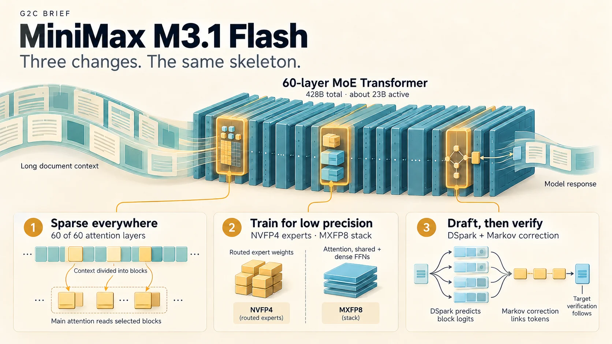
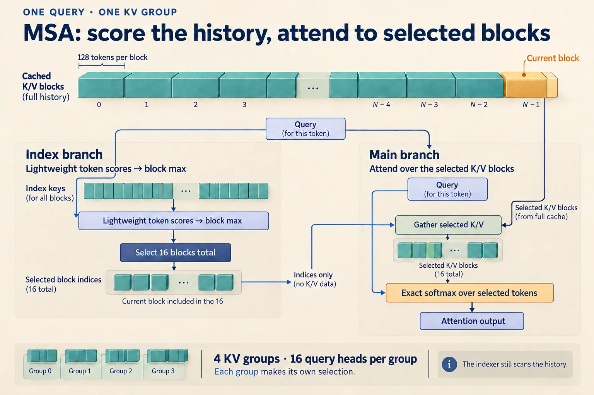
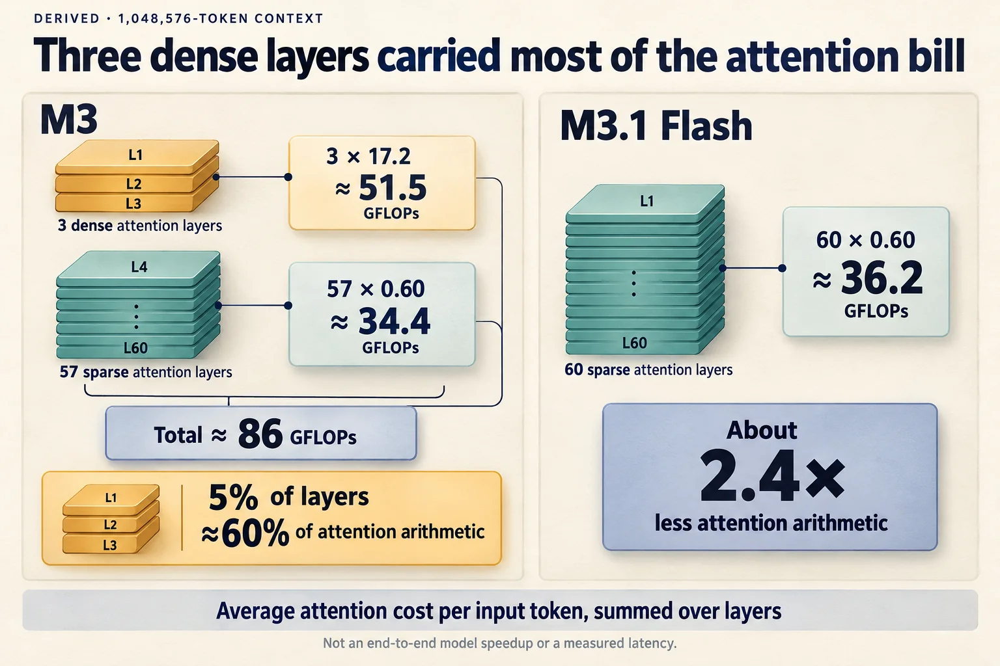
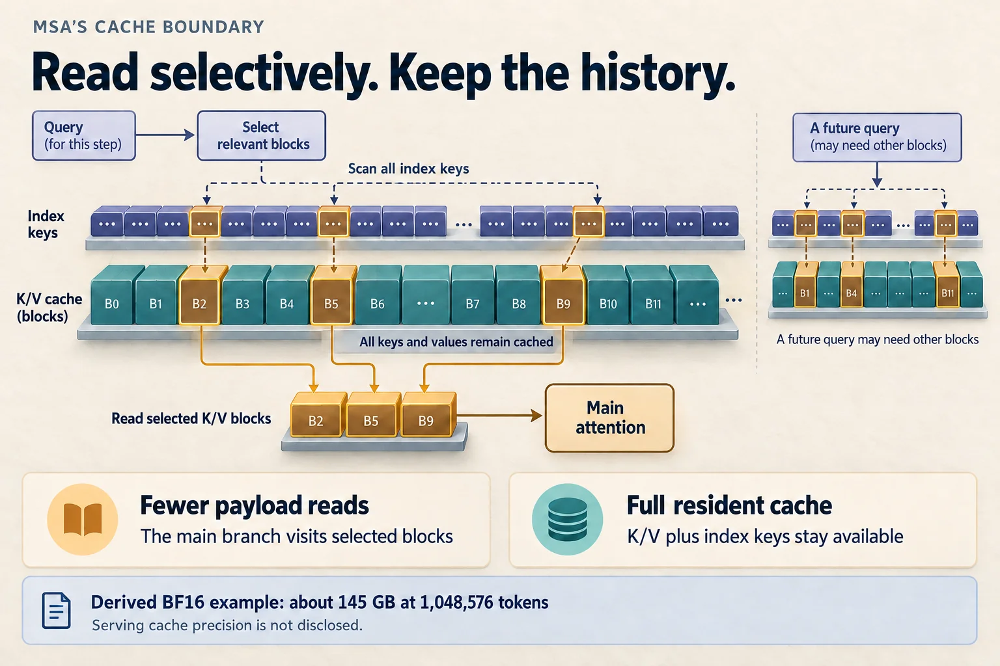
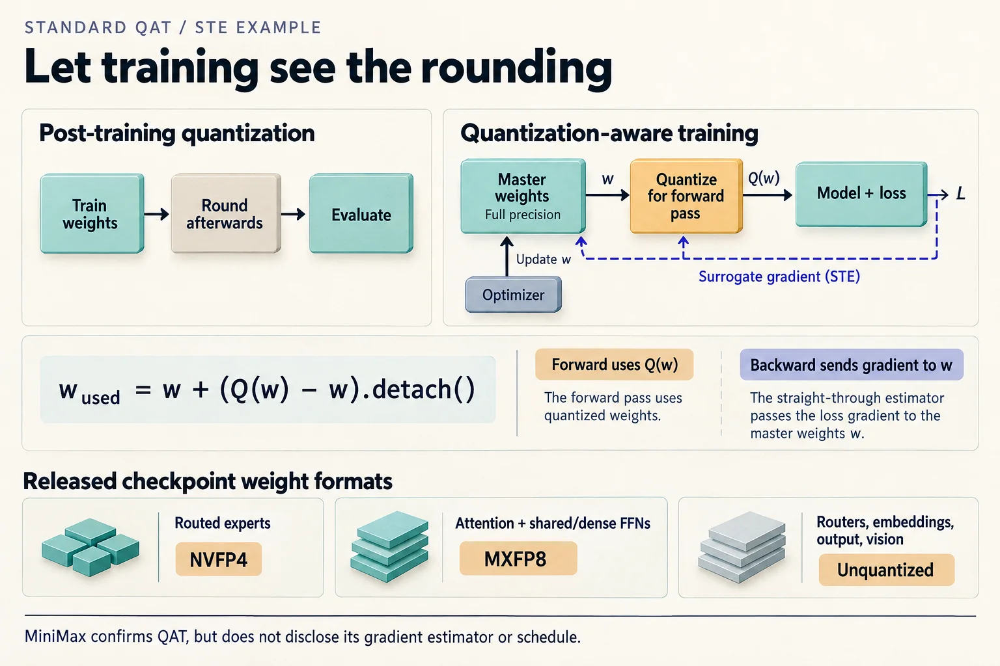
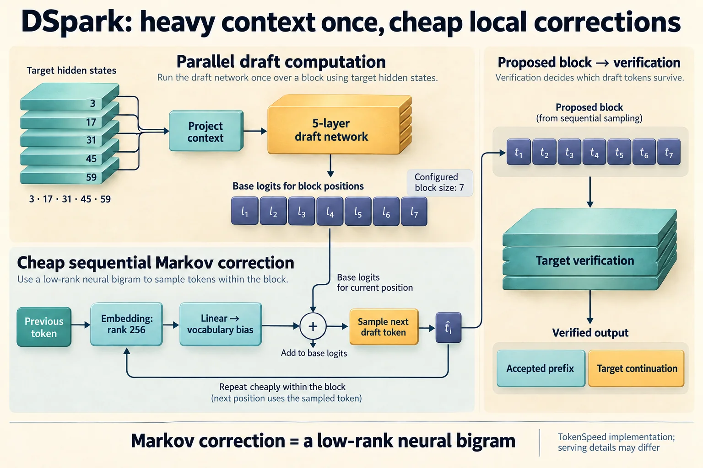

# G2C Brief — MiniMax M3.1 Flash: three changes, read from the config

> **Question this Brief answers:** *How do you make a 428B model about three times faster without changing its skeleton?*



On October 23, 2026, MiniMax published the weights for
[MiniMax-M3.1-Flash](https://huggingface.co/MiniMaxAI/MiniMax-M3.1-Flash), four
days after
[launching it](https://www.minimax.io/blog/minimax-m31f) on its API. It is a
mixture-of-experts model with about 428B parameters, 23B of them active per
token, a 1M-token context window, and text, image, and video input. MiniMax
says it runs "nearly three times faster" than its predecessor, MiniMax-M3, and
cuts the cost of agent workloads by about 70%.

There is no technical report for M3.1 Flash, and MiniMax hasn't promised one.
What there is turns out to be enough. The model card names exactly three
changes from M3:

1. **Sparse attention in every layer.** M3 kept three layers of ordinary dense
   attention; M3.1 Flash replaces them.
2. **Quantization-aware training.** The released weights are 4-bit and 8-bit,
   and the model was trained to expect that.
3. **A new speculative-decoding drafter.** DSpark, the drafter introduced with
   DeepSeek V4.1, replaces M3's own multi-token-prediction modules.

Because both models' weights and configs are public, each claim can be checked
by diffing two JSON files and counting tensors, and this Brief does that. The
sparse attention mechanism itself has a paper,
[MiniMax Sparse Attention](https://arxiv.org/abs/2606.13392) (MSA), which
supplies the explanation the model card leaves out.

For a g2c graduate, each change connects to something you built:

- MSA is attention (Module 07) with a learned selector in front of it, and
  its speedups follow directly from the prefill-and-decode accounting in
  [Module 16](../modules/16-inference.md#prefill-and-decode).
- Quantization-aware training is the sequel to Module 16's quantization
  exercise, where post-training quantization fell off a cliff.
- DSpark's "Markov head" is, almost line for line, the neural bigram model you
  built in [Module 06](../modules/06-language-models.md).

This Brief assumes no background on M3 or on MiniMax.

---

## Snapshot

| | |
|---|---|
| **Subject** | MiniMax-M3.1-Flash, compared against its predecessor MiniMax-M3 |
| **Primary sources** | [M3.1 Flash model card and config](https://huggingface.co/MiniMaxAI/MiniMax-M3.1-Flash) (repo revision `54e4e69`); [M3 model card and config](https://huggingface.co/MiniMaxAI/MiniMax-M3); [MiniMax Sparse Attention](https://arxiv.org/abs/2606.13392) (arXiv 2606.13392v2, June 2026); [launch post](https://www.minimax.io/blog/minimax-m31f) (October 19, 2026) |
| **Weights** | Public since October 23, 2026, under the MiniMax Community License: free for non-commercial use; commercial use requires attribution, and written authorization above US$20M in yearly revenue |
| **Technical report** | None for M3.1 Flash. The MSA paper covers the attention mechanism, validated on a smaller 109B research model. |
| **Implementation read** | [TokenSpeed](https://github.com/lightseekorg/tokenspeed)'s MiniMax-M3 and DSpark model files, a third-party serving engine listed on the model card. vLLM and SGLang recipes also exist. |
| **Independent evaluation** | [Artificial Analysis](https://artificialanalysis.ai/models/minimax-m3-1-flash), run against MiniMax's API before the weights were released |
| **Last verified** | October 23, 2026 |

The labels follow the [standard Brief meanings](index.md), with two notes for
this release:

- **Derived** covers arithmetic from the configs, counts of the published
  tensors, and statements read from code. When the code is TokenSpeed's
  rather than MiniMax's, the Brief says so, because a third-party engine can
  differ from MiniMax's own serving stack.
- **Reported** claims about M3.1 Flash come from the model card and launch
  post. Claims about MSA's quality come from the paper's experiments on a
  109B model, not on M3.1 Flash itself.

---

## The model in one page

**Derived, from the config.** The text model is a 60-layer Transformer:

| Piece | Setting |
|---|---|
| Hidden size | 6,144 |
| Attention | grouped-query: 64 query heads sharing 4 key-value heads (head dimension 128), so each KV head serves a "group" of 16 query heads |
| Feed-forward | layers 0–2 dense; layers 3–59 mixture-of-experts with 128 routed experts (top 4 per token) plus 1 shared expert, each a SwiGLU MLP of width 3,072 |
| Router | sigmoid scores with a learned bias, the DeepSeek-style balancing scheme |
| Vocabulary | 200,064 tokens |
| Context | up to 1,048,576 positions |
| Vision | a 32-layer ViT front end feeding image and video patches into the same stream |

**Derived.** Counting from those settings: the 128 routed experts across 57
layers hold **413.1B** parameters. That is 97% of the model. Each token uses 4
of them, so a token touches about **23.5B** parameters, excluding the embedding
and output matrices. That's the card's "23B activated" figure.

[Beyond: MoE](../beyond/moe.md) builds the routing mechanism at laptop scale.
Everything in this section is unchanged from M3. The full diff between the two
configs is short:

| Config field | M3 | M3.1 Flash |
|---|---|---|
| `sparse_attention_freq` (layers using sparse attention) | 57 of 60 (layers 0–2 dense) | **60 of 60** |
| `quantization_config` | none (BF16 weights) | **NVFP4 routed experts, MXFP8 elsewhere** |
| `num_mtp_modules` | 7 | **none**; a separate `dspark/` draft model ships instead |
| `rope_theta` | 5,000,000 | 10,000,000 |
| `vision_config.image_size` | 2,016 | 672 |

(**Derived.** The last two rows aren't mentioned on the model card. The RoPE
base doubling is the kind of change usually made when retuning long-context
behavior; **Not disclosed** why it changed. The vision setting may only be a
default for the processor's tiling. The image grid list is identical in both
configs.)

---

## Change 1: sparse attention in every layer

### What MSA does

Dense attention compares every query with every earlier key. At a 1M-token
context that's a million dot products per query, per head, per layer. MSA
splits each attention layer into two branches
([paper](https://arxiv.org/abs/2606.13392), Section 3):


*Choose where to read before doing the expensive attention. **Reported:** [MSA §3](https://arxiv.org/html/2606.13392v2#S3) reserves one of the selected block slots for the local block. **Derived:** the [released config](https://huggingface.co/MiniMaxAI/MiniMax-M3.1-Flash/blob/54e4e69/config.json) sets 16 blocks of 128 tokens and four KV groups. The illustrated selections are schematic, not measured attention maps.*

Three design choices are worth noticing:

- **Selection is per KV group, by block.** All 16 query heads that share a KV
  head share one selection. Blocks of 128 consecutive tokens keep the memory
  reads contiguous. **Reported:** the paper's ablation found block sizes of 32,
  64, and 128 gave nearly identical quality, so the largest, fastest block
  won.
- **The selector learns from the attention it replaces.** Top-k is not
  differentiable, so the language-modeling loss can't train the index branch.
  Instead, a KL loss pushes the index branch's distribution toward the main
  branch's actual attention weights, averaged across the group's heads, on the
  selected tokens. Two stop-gradients confine that loss to the two index
  projection matrices: the main branch's attention is detached, and so is the
  index branch's *input*. The backbone never sees it.
- **The selector is warmed up first.** For the first stretch of training, both
  branches run dense attention while the index projections learn. Sparse
  selection switches on only after the selector has something to go on.
  **Reported:** the same recipe converts an already-trained dense model
  ("near-lossless conversion from pretrained GQA checkpoints").

**G2C interpretation.** The selector is a student trained by distillation
against a teacher that is attention itself. It is the same move as a probe in
interpretability, or as Module 15's habit of measuring a cheap proxy against
the expensive real thing. The stop-gradient on its input is what keeps it a
*measurement* of the backbone, rather than a second objective bending the
backbone to be easier to index.

### The config is the paper's final recipe

The paper's appendix ablates several choices, and M3.1 Flash's
`sparse_attention_config` matches each of its conclusions (**Derived**, config
against paper):

| Config setting | Paper's finding |
|---|---|
| `sparse_block_size: 128`, `sparse_topk_blocks: 16` | The deployed setting; the top-k kernel is tuned for small k at this block size |
| `sparse_score_type: "max"` | Blocks are scored by their maximum token score (max-pooling) |
| `sparse_init_block: 0` | No forced "attention sink" block. The model learned to select the first block on its own (Appendix C.2). |
| `sparse_local_block: 1` | Only the query's own, partly filled block is forced (Appendix C.2) |
| `sparse_disable_index_value: 1` (every layer) | The index branch's extra output path was removed once warmup made it unnecessary (Appendix C.3) |

**Reported.** The paper's visualizations show what the learned selector picks:
every head selects the local neighborhood and the first block (the "sink"),
then spends the rest of its budget on a few long-range stripes. Different
groups pick different stripes. A fixed sliding window with the same budget had
higher perplexity on agent tasks throughout training.

### Where the speedup comes from, and where it stops

The paper gives the attention cost of a whole sequence of length `N`
(equation 12). Dividing by `N` gives an average per token:

```text
   dense GQA:   2 · H_q · d_h · N                  =  16,384 · N
   MSA:         H_kv · d_idx · N  +  4 · H_q · d_h · k · B_k
                └─ index branch ┘    └──── main branch ────┘
             =  512 · N  +  67.1 million
```

**Derived** (using M3.1 Flash's settings: `H_q = 64`, `H_kv = 4`, `d_h = 128`,
`d_idx = 128`, `k = 16`, `B_k = 128`):

| Context `N` | Dense, per layer | MSA, per layer | Ratio |
|---:|---:|---:|---:|
| 131,072 | 2.15 GFLOPs | 0.13 GFLOPs | 16× |
| 1,048,576 | 17.2 GFLOPs | 0.60 GFLOPs | **28.4×** |

That 28.4× is the paper's headline number, recovered from the formula. Notice
the shape of the MSA cost. The main branch is a constant, but the index branch
still grows with `N`: the selector has to look at every block to pick the best
16. **Derived:** as `N` grows, the ratio approaches `16,384 / 512 = 32×` and
never passes it. The index branch is the part of attention that stays
quadratic over a whole sequence. It's just 32 times cheaper per key.

Decode tells a different story, because decode is limited by memory reads,
not arithmetic (the Module 16 argument). For one decode step at context `N`,
per layer:

```text
   dense GQA reads every cached key and value:   2 · H_kv · d_h · N      = 1,024 · N values
   MSA reads every index key, plus 2,048 tokens   d_idx · N + H_kv · 2,048 · 2 · d_h
   of keys and values for each of the 4 groups   = 128 · N + 2.1 million values
```

**Derived:** at a 1M context that's about 1,074 million values against 136
million, a ratio of about **7.9×**. **Reported:** the paper measured a **7.6×**
decode speedup at 1M on H800 GPUs. The measurement lands right where a pure
memory-traffic estimate says it should, which is strong evidence that decode
really is a bandwidth problem. The measured prefill speedup is 14.2×, well
short of the 28.4× arithmetic ratio. The paper attributes the gap to
selection, gathering, and load-balancing overheads that dense attention
doesn't have.

### What removing three dense layers buys

M3 kept its first three layers dense. That sounds minor: 3 of 60 layers.

**Derived.** Using the per-token figures above, at a 1M context M3 spends
3 × 17.2 = 51.5 GFLOPs on its three dense layers and 57 × 0.60 = 34.4 GFLOPs
on its 57 sparse layers. **The three dense layers did 60% of M3's attention
arithmetic.** M3.1 Flash's 60 sparse layers cost 36.2 GFLOPs in total, 2.4×
less than M3's 86. At 128K the dense layers' share was 46%, and removing them
cuts attention cost 1.75×.


*Count work, not layers. **Derived:** the [paper's cost equation](https://arxiv.org/html/2606.13392v2#S3.SS3) and released configs put about 60% of M3's attention arithmetic in just three layers at `N = 1,048,576`. These are average attention FLOPs per input token, summed over layers; the 2.4× ratio is not a measured end-to-end speedup.*

For scale, the rest of the network (projections, experts, and so on) costs
about 47 GFLOPs per token no matter the context, twice the 23.5B active
parameters. At a 1M context, M3's attention alone cost more than the rest of
the network. M3.1 Flash's costs less.

**Not disclosed:** why M3 kept those layers dense, and what removing them cost
in quality. The paper's own 109B experiments ran MSA in every layer, so all
sparse layers is the configuration the paper actually validated. **G2C
interpretation:** M3's three dense layers look like a production hedge that
the team has now judged unnecessary.

### What MSA doesn't shrink

MSA saves compute and memory *reads*. It doesn't save memory. Any block might
be selected by some future query, so every key and value must stay in the
cache, plus a 128-dimensional index key per token.

**Derived.** Per token, per layer, the cache holds `2 × 4 × 128 = 1,024` values
for keys and values plus 128 for the index key. That's 69,120 values per token
across 60 layers. In BF16 that's 138 KB per token, or about **145 GB for one
1M-token sequence**. Halve that if the cache is stored in 8 bits. **Not
disclosed:** the precision MiniMax's own serving uses for the cache.

Compare the [DeepSeek V4.1-Flash Brief](deepseek-v4.1-flash.md#your-kv-formula-pushed-to-the-limit),
where the whole architecture was built around a global cache of 890 bytes per
token. The [efficient-attention map](../beyond/attention-efficiency.md#visit-fewer-token-rows)
separates the costs that "sparse attention" can mean: the *payload cache*
attended to, the *index* used to find candidates, and the *selection work*.
**G2C interpretation:** MSA attacks selection and payload *reads*. V4.1
attacks payload *storage*. They are answers to different bills, and a model
can need both.


*Selection changes the reads, not which history must remain available. **Derived:** the [config](https://huggingface.co/MiniMaxAI/MiniMax-M3.1-Flash/blob/54e4e69/config.json) implies 69,120 cached values per token across 60 layers; at BF16, a full-length sequence occupies about 145 GB. **Not disclosed:** the cache precision used by MiniMax's service. Weight quantization does not establish cache precision.*

---

## Change 2: quantization-aware training

### What the checkpoint actually contains

**Reported.** "The routed MoE experts and the attention paths are quantized
during training, reducing memory footprint and improving serving efficiency."
The config says how:

- **Routed experts: NVFP4.** 4-bit floating-point values in blocks of 16, each
  block with its own 8-bit scale factor.
- **Everything else in the transformer stack: MXFP8.** This covers attention
  projections, the index branch, the shared experts, and the three dense
  feed-forward layers. Values are 8-bit floats in blocks of 32, each block
  with a power-of-two scale.
- **Left unquantized:** the router gates, the token embeddings, the output
  head, and the whole vision tower.

**Derived.** The published tensor counts confirm this split exactly:

| Stored as | Elements in the checkpoint | Matches |
|---|---:|---|
| packed 4-bit (two per byte) | 206,561,083,392 bytes = **413,122,166,784** values | 128 routed experts × 57 layers × 3 matrices × 6,144 × 3,072, exactly |
| 8-bit float | **10,560,208,896** | attention + index branch + shared experts + dense FFN layers, exactly |
| BF16 | 3,323,222,528 | embeddings and output head (2.46B), plus the vision tower and projector |

The weight files total 250 GB, against 854 GB for M3's BF16 release
(**Derived**, about 3.4× smaller).

**G2C interpretation.** The quantization budget follows the parameter count.
The routed experts are 97% of the parameters, so they get the most aggressive
format. The small, sensitive pieces stay in higher precision. Router gates
decide which experts run, and a rounding error there changes *which*
computation happens, not just how precisely.

### Why 4-bit experts matter for speed

Recall Module 16's ceiling on decode speed: tokens per second can't exceed
memory bandwidth divided by the bytes read per token. For an MoE model, the
bytes per token are mostly the active experts.

**Derived.** Each token reads 4 routed experts in each of 57 layers: 12.9B
parameters. In BF16 that's 25.8 GB per token. In packed 4-bit it's 6.5 GB, plus
small block scales. Cutting the bytes per token about 4× raises the decode
ceiling about 4× on the same hardware, before any change to the architecture.

### What "quantization-aware" adds

[Module 16](../modules/16-inference.md)'s fifth exercise quantizes a finished
model *after* training (post-training quantization, PTQ) and watches quality
fall off a cliff as the bit width drops. The weights were learned without any
idea they'd be rounded. At low bit widths, the rounding errors are as large as
the weights' own fine structure, and they compound through the layers.

Quantization-aware training (QAT) lets the model see the rounding while it
learns. The forward pass uses quantized weights. The backward pass needs a
gradient through `round()`, which is zero almost everywhere. The standard fix
is the **straight-through estimator**: pretend rounding is the identity when
computing gradients, and keep full-precision "master" weights for the
optimizer to update:

```python
w_used = w + (quantize(w) - w).detach()   # forward: quantize(w); backward: gradient flows to w
```

The optimizer then finds weights that work *after* rounding, often weights
sitting comfortably inside a quantization bucket instead of on an edge.


*Train against the rounding the model will encounter. **G2C interpretation:** the loop illustrates the standard STE expression above, not MiniMax's disclosed implementation. **Derived:** the weight-format cards follow the [released config](https://huggingface.co/MiniMaxAI/MiniMax-M3.1-Flash/blob/54e4e69/config.json). **Not disclosed:** MiniMax's gradient estimator and QAT schedule.*

**Not disclosed:** MiniMax's recipe. The sources don't say whether
quantization ran for all of training or only a final phase, whether it used a
straight-through estimator or another method, or how much quality it
recovered compared with quantizing M3.1's weights after the fact. The card
says only that the experts and attention paths "are quantized during
training." For M3, MiniMax published BF16 weights alongside a separate MXFP8
"quantized variant." With M3.1 Flash, the quantized weights are the only
weights.

**G2C interpretation.** That last point has a cost for anyone building on the
model. Fine-tuning starts from 4-bit experts, and there's no BF16 master copy
to return to. NVFP4 is also a hardware-specific format, with native support on
NVIDIA's newest GPUs.

---

## Change 3: DSpark replaces multi-token prediction

### The drafter

[Beyond: speculative decoding](../beyond/specdec.md) builds the core idea: a
cheap drafter proposes several tokens, the full model checks them all in one
pass, and stochastic verification keeps the target's output distribution
exact.

M3 drafted with seven multi-token-prediction modules, which the card calls an
"EAGLE-like MTP approach": small modules chained to propose one token after
another. M3.1 Flash drops them for **DSpark**, the drafter DeepSeek introduced
with V4.1 (see the
[V4.1-Flash Brief](deepseek-v4.1-flash.md#four-components-outside-the-attention-story)).
The draft model ships in its own `dspark/` folder, 2.3 GB.

**Derived, from `dspark/config.json`:**

- **A small, separate Transformer.** It has 5 dense layers at the target's
  width, using sliding-window attention over the last 4,096 positions.
- **It reads the target's mind.** Hidden states from five of the target's
  layers (3, 17, 31, 45, and 59) are concatenated and projected into the
  draft model as context.
- **It drafts a block at once.** Positions in a 7-token block are filled with a
  placeholder "mask" token, and one forward pass predicts all of them in
  parallel (`block_size: 7`, `mask_token_id`).
- **A Markov head chains the block back together.** Rank 256.
- **A confidence head estimates which drafts will survive.**

**Derived, from TokenSpeed's implementation** (third-party). The draft network
is non-causal inside the block: every position sees the whole block, including
positions after it. That's how one forward pass can fill seven slots.

### The Markov head is your bigram model

A single parallel pass has a weakness. Each position predicts its token
without knowing what the drafter chose for the position before it. The
drafts can be individually plausible and jointly incoherent.

DSpark's fix is small. **Derived, from TokenSpeed's code:**

```python
markov_w1 = nn.Embedding(vocab_size, 256)               # previous token → 256-dim vector
markov_w2 = nn.Linear(256, vocab_size, bias=False)      # vector → a bias over the vocabulary
bias = markov_w2(markov_w1(previous_token))             # added to that position's logits
```

The expensive draft network runs once. Then the drafter samples position 1,
uses that token to compute a bias for position 2's logits, samples position 2,
and so on down the block. The chain is cheap because each step is one
embedding lookup and one matrix-vector product.

Compare Module 06's `NeuralBigramLM`: embed the previous token, apply a linear
layer, produce logits over the vocabulary. It's the same model. Here it's
used as a correction term instead of a whole language model. **Derived:**
with rank 256, the head has `2 × 200,064 × 256 ≈ 102M` parameters. A full
bigram *table* over this vocabulary would need `200,064² ≈ 40 billion`
entries. The low-rank factorization is the same trade Module 06 made between
`CountsBigramLM` and `NeuralBigramLM`.

**G2C interpretation.** The design splits the work by difficulty. Long-range
context, which is expensive, is handled once per block by a network that can
see the target's hidden states. Local fluency, which is cheap, is handled
token by token by a bigram. That's a recognizable pattern: spend heavy compute
where the information is, and light compute where the constraint is simple.


*One expensive draft pass, followed by a cheap local chain. **Derived:** the [draft config](https://huggingface.co/MiniMaxAI/MiniMax-M3.1-Flash/blob/54e4e69/dspark/config.json) supplies the dimensions and layer taps; [TokenSpeed's third-party implementation](https://github.com/lightseekorg/tokenspeed/blob/main/python/tokenspeed/runtime/models/dspark.py) supplies the Markov correction. The sketch shows the division of work, not an observed acceptance rate or MiniMax's private serving policy.*

### The confidence head, and who uses it

The draft config sets `enable_confidence_head: true`, and the checkpoint
contains its weights (**Derived**). That is the head the
[DeepInfer Brief](deepinfer.md#4-speculative-decoding-with-a-budget) showed
DeepSeek using to *budget* verification: check only the draft tokens with the
best expected return, sized to the current server load.

**Derived, from TokenSpeed's code.** The open implementation doesn't load the
confidence head ("the full block is verified every step"). So the capability
ships in the weights, but whether a given serving engine uses it is up to that
engine. **Not disclosed:** whether MiniMax's own service budgets verification,
and the acceptance rates DSpark achieves on this model.

**G2C note.** DSpark is now in production at two independent organizations,
DeepSeek and MiniMax, with the drafter's weights and config public for both.
Under the Brief rules, that is the recurrence the Beyond-module threshold asks
for, and Beyond: speculative decoding already covers the verification side.
It's evidence for extending that module to block drafting, not a commitment.

---

## Reading the evidence

**Reported (model card).** Selected results for M3.1 Flash: 73.7% on DeepSWE
v1.1, 61.7 on OSWorld 2.0, 76.2 on BankerToolBench, 29.6 on Agents' Last
Exam, and 82.2 on CyberGym. The card compares against DeepSeek V4.1
Flash-1017, Kimi K3, GLM-5.3, GPT-5.6 Sol, and Opus 5, with harness and
context settings listed per benchmark. Several agentic results use Claude
Code as the harness.

**Reported (Artificial Analysis, measured against MiniMax's API around
launch).** The two snapshots available differ slightly:

- **Intelligence Index:** 42–43, up from 29 for M3. DeepSeek V4.1 Flash-1017
  scored 45.
- **Cost per index task:** about $0.22, down from $0.51 for M3.
- **Output tokens to run the index:** about 180–189 million. That's well
  below GLM-5.3 Flash's 324 million.
- **Hallucination ([via VentureBeat](https://venturebeat.com/technology/minimaxs-new-m3-1-flash-beats-deepseek-and-opus-5-on-a-key-business-benchmark-at-lower-cost-but-with-a-high-hallucination-rate)).**
  On AA-Omniscience, the model answered 56% of questions correctly, more than
  DeepSeek's 43%. But of the questions it didn't get right, 93% got a wrong
  answer rather than a refusal or a partial answer. It almost never says "I
  don't know."
- **Speed:** 87 output tokens per second on MiniMax's API in Artificial
  Analysis's measurement, against MiniMax's own claim of 170+ (median) and
  200+ tokens per second.

**G2C interpretation.** The cost story has two parts that are easy to blur.
The per-token price is low ($0.15 per million input tokens, $0.60 per million
output), and the architecture changes plausibly explain why serving is cheaper.
But the model also uses fewer tokens per task than its peers, and that is a
property of its training, not its attention. Speed numbers depend heavily on
load, batching, and whether speculative decoding is tuned for the request mix.
Module 16's benchmark section is the right lens: name the phase, the batch,
and the context before comparing tokens per second.

The hallucination figure is a calibration finding in
[Module 15](../modules/15-evaluation.md)'s sense. A model that never abstains
can score well on accuracy and still be confidently wrong most of the time
when it misses. System prompts and harnesses can sometimes train that out at
the application layer. The base behavior is what the number reports.

---

## Where informed readers will push back

- **The quality evidence for sparse-everywhere is indirect.** The MSA paper's
  experiments are on a 109B model with 6B active parameters, trained for 3T
  tokens, not on M3.1 Flash. Even there, sparse models trailed dense ones on
  some long-context subtasks (HELMET-128K retrieval-augmented generation, −2.1;
  RULER-128K word extraction, −1.35), while gaining on others. **Not
  disclosed:** any long-context comparison between M3 and M3.1 Flash, the
  evaluation that would show what removing the last three dense layers cost.
- **A 1M context is still expensive to hold.** MSA's savings are in compute
  and reads. A full-length sequence still needs on the order of 70–145 GB of
  cache, depending on precision. The card is honest that "usable context
  length and throughput depend on GPU memory and the serving configuration."
- **The QAT recipe is a black box.** The release proves *what* was quantized,
  down to the tensor. It says nothing about *how*: when, with what gradient
  estimator, or at what cost in quality.
- **Quantized-only weights narrow who can build on it.** There is no BF16
  checkpoint. Fine-tuning, distillation, or interpretability research starts
  from NVFP4 experts and inherits their hardware assumptions.
- **Open implementations are partial.** TokenSpeed skips the confidence head.
  Transformers support is "in progress." Reproducing MiniMax's own serving
  speed depends on implementation details that aren't public.
- **Confident wrong answers.** The 93% hallucination rate on missed questions
  is a real deployment concern for any use where an unsupported answer is
  worse than none.
- **The license is not open source.** Commercial use requires attribution, and
  a separate authorization above US$20M in yearly revenue.

---

## The laptop boundary, and what you can check yourself

You can't run M3.1 Flash on a course machine. **Derived:** the weight files
alone are 250 GB, four times the largest unified-memory configuration in the
course's hardware contract, before any cache. Nothing here asks you to.

Each mechanism, though, has a laptop-sized version. These sketches are
optional and ungraded.

**Look at your Markov head.** Module 06's `NeuralBigramLM` *is* the Markov
head. Check that its parameter count matches `V·D + D·V` (plus a bias), then
plug in `V = 200,064` and `D = 256`. Then sample a few tokens from it alone.
The output is locally fluent and globally aimless, which is exactly the
division of labor DSpark relies on: the bigram supplies local fluency, and
the draft network supplies everything else.

**Compare QAT with Exercise 5's cliff.** The straight-through estimator is
three lines on top of Exercise 5's fake quantizer. This version uses block
scales, as NVFP4 does:

```python
def fake_quant(w, bits, block=16):
    qmax = 2 ** (bits - 1) - 1
    blocks = w.reshape(-1, block)
    scale = blocks.abs().amax(1, keepdim=True).clamp(min=1e-8) / qmax
    return ((blocks / scale).round().clamp(-qmax, qmax) * scale).reshape(w.shape)

def ste(w, bits):
    return w + (fake_quant(w, bits) - w).detach()   # quantized forward, straight-through backward
```

Use `ste(W, bits)` in place of `W` inside a forward pass, fine-tune briefly,
then evaluate with `fake_quant`. In a small trial on a toy two-layer MLP,
fine-tuning through `ste` cut the 2-bit error about 7× compared with
quantizing after training, and the 3-bit error about 2×. At 4 bits it made no
difference, because block scales already made post-training quantization
nearly lossless. Your results on a real language model will differ. The
pattern to look for is QAT mattering more as the bits get scarcer.

**Measure what a block selector would catch.** Take any attention-probability
matrix from your own model (Module 07's attention weights, one head, one
sequence). For each query, sum the attention mass inside the top-k blocks by
max score and divide by the total. This is the paper's "score recall" with a
perfect selector:

```python
def topk_block_recall(attn, block=16, k=4):        # attn: (T, T), causal, rows sum to 1
    T = attn.shape[0]
    nblocks = (T + block - 1) // block
    padded = torch.nn.functional.pad(attn, (0, nblocks * block - T))
    per_block = padded.view(T, nblocks, block)
    mass = per_block.sum(-1)                         # attention mass in each block
    score = per_block.amax(-1)                       # MSA scores blocks by their max
    top = score.topk(min(k, nblocks), dim=-1).indices
    return mass.gather(-1, top).sum(-1)              # fraction of each query's attention captured
```

If a few blocks capture most of the mass, sparse attention would have cost
your model little. That's the empirical bet MSA makes at a million tokens.

**Redo the arithmetic.** Every Derived number in Change 1 comes from three
lines of the config and one equation from the paper. Change `k`, the block
size, or the index dimension and watch where the 32× ceiling moves.

---

## Coverage map

| Mechanism | Coverage | Where |
|---|---|---|
| Grouped-query attention, softmax attention | **Built in g2c** | [Module 07](../modules/07-attention.md), [Module 08](../modules/08-multi-head-attention.md) |
| Prefill vs decode cost; decode limited by memory bandwidth | **Built in g2c** | [Module 16](../modules/16-inference.md#prefill-and-decode) |
| Mixture-of-experts routing | **Built in g2c** | [Beyond: MoE](../beyond/moe.md) |
| Speculative decoding: draft, verify, accept | **Built in g2c** | [Beyond: speculative decoding](../beyond/specdec.md) |
| Low-rank bigram model (the Markov head) | **Built in g2c** | [Module 06](../modules/06-language-models.md) `NeuralBigramLM` |
| Post-training fake quantization | **Built in g2c** | Module 16, Exercise 5 |
| Learned block-sparse attention with a distilled selector | **Not yet covered** | [Beyond: Sparse Attention](../beyond/sparse-attention.md) is drafted, not yet buildable; the [efficient-attention map](../beyond/attention-efficiency.md) explains the payload / index / selection split |
| Quantization-aware training, straight-through estimator | **Conceptual bridge** | Module 16's quantization exercise plus Module 01's autodiff |
| Block formats (NVFP4, MXFP8) | **Conceptual bridge** | Module 16's quantization section |
| Block-parallel drafting conditioned on target hidden states | **Not yet covered** | Beyond: speculative decoding covers drafting one token at a time |
| Confidence-budgeted verification | **Conceptual bridge** | [DeepInfer Brief](deepinfer.md#4-speculative-decoding-with-a-budget); Module 15 calibration |

---

## A reading route

1. **This Brief's "The model in one page"** next to the two `config.json`
   files. Find the five diff rows yourself.
2. **[MSA paper](https://arxiv.org/abs/2606.13392), Sections 3 and 5.4.** The
   architecture and the efficiency results. Then Appendix C.2–C.3, the
   ablations that explain the config.
3. **This Brief's arithmetic** for the 28.4× and 7.9× figures, redone with
   your own numbers.
4. **[`dspark/config.json`](https://huggingface.co/MiniMaxAI/MiniMax-M3.1-Flash/blob/main/dspark/config.json)**
   and TokenSpeed's
   [`dspark.py`](https://github.com/lightseekorg/tokenspeed/blob/main/python/tokenspeed/runtime/models/dspark.py)
   (130 lines), next to your Module 06 bigram model.
5. **The [DeepInfer Brief](deepinfer.md)'s Section 4** for what the
   confidence head is for.
6. **[Artificial Analysis](https://artificialanalysis.ai/models/minimax-m3-1-flash)**
   for the independent numbers, keeping in mind they predate the open
   weights.

---

## After this Brief, you should be able to

- Describe the three changes from M3 to M3.1 Flash and point to the config
  field that confirms each one.
- Explain how MSA's index branch picks blocks, why it's trained with a KL
  loss behind stop-gradients, and why it still costs time proportional to the
  context.
- Derive the 28.4× attention-compute reduction and the roughly 8× decode
  advantage at a 1M context, and say which Module 16 phase each one belongs
  to.
- Explain why three dense layers out of sixty were most of M3's attention
  cost at long context.
- Say what sparse attention does and doesn't shrink, and contrast it with an
  architecture built to shrink the cache.
- Explain quantization-aware training and the straight-through estimator, and
  why the routed experts got the most aggressive format.
- Recognize DSpark's Markov head as a low-rank bigram model, and explain how
  it turns a parallel draft into a coherent one.
- Read a vendor speed claim and an independent measurement side by side, and
  say why they can both be true.
