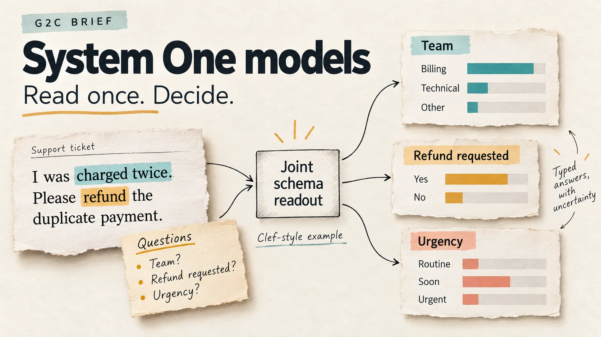
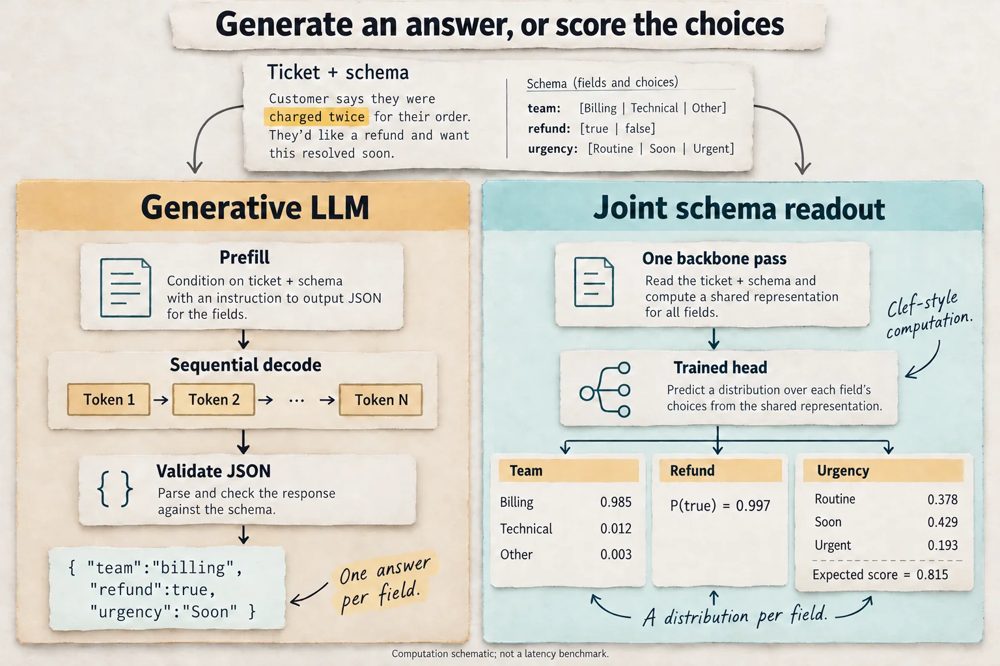
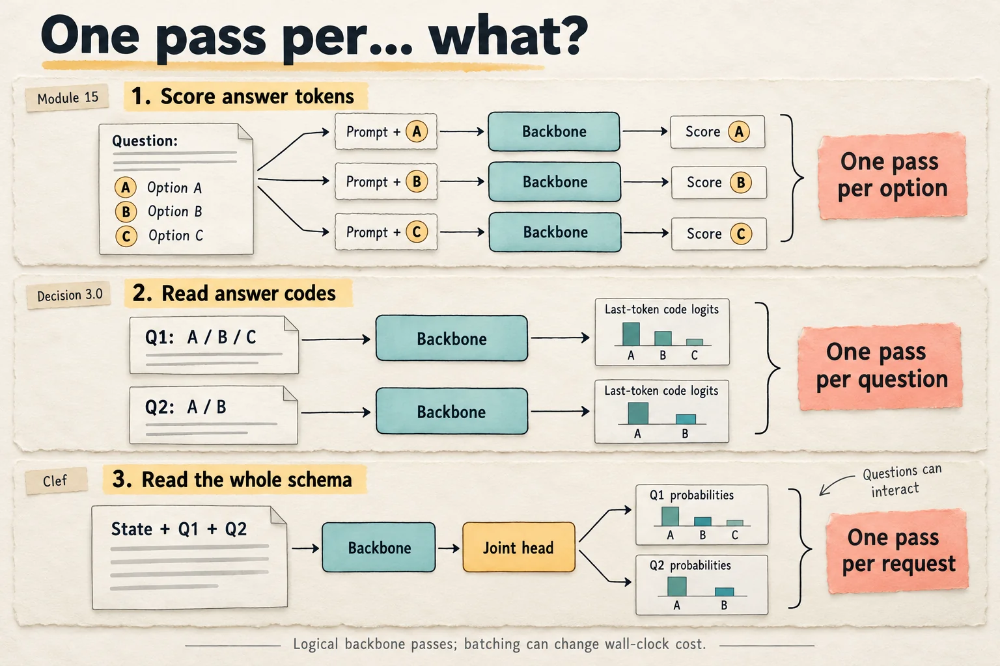
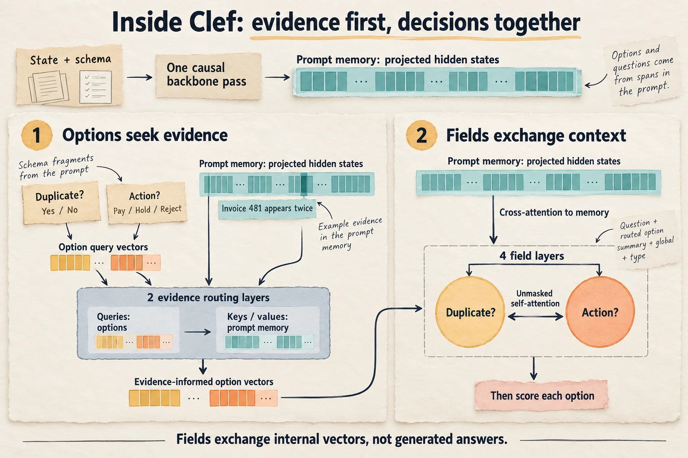
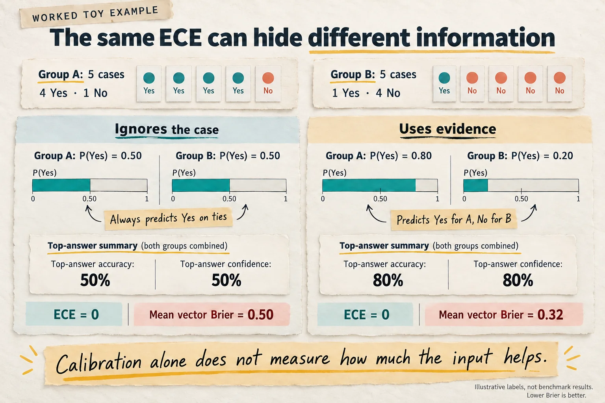
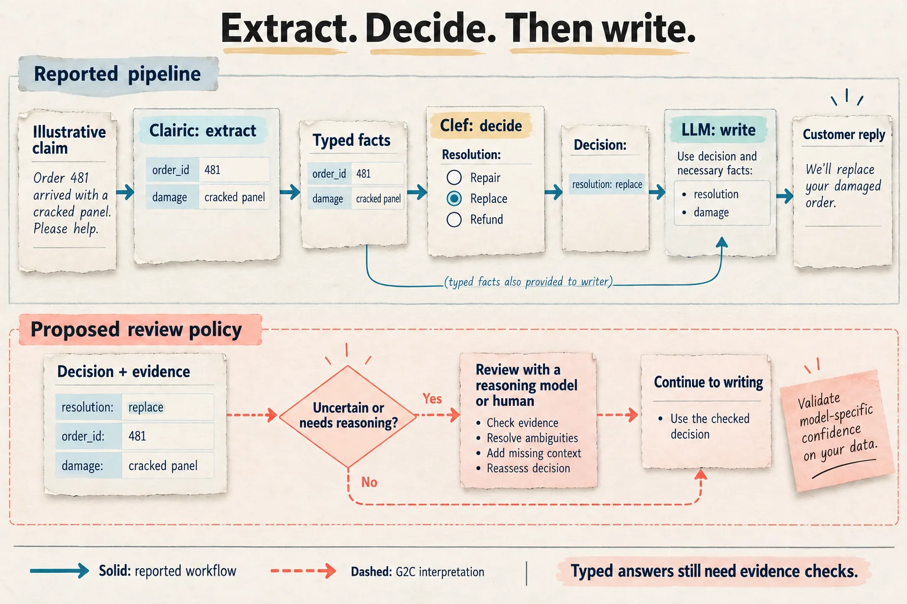

# G2C Brief — System One models: decisions without generation

> **Question this Brief answers:** *What do you get if a language model reads its input once and never writes a word?*



On October 19, 2026, Cloudflare released a preview of
[Clairic](https://blog.cloudflare.com/clairic-extraction-model), which it calls
the first of "a new System One class of extraction models." Give it a receipt
and ask for the total, the date, and the vendor, and it returns a number, a
date, and a span of the input. It does not generate any text. Clairic is the
newest entry in a category that barely existed five weeks ago. TypeSafe named
the category in mid-September, and since then Ollama, Cloudflare, Liquid AI,
Together AI, Bespoke Labs, and the vLLM project have all shipped models or
infrastructure for it.

The pitch is simple. A lot of what production software asks a language model
to do isn't writing. It's deciding: which team gets this ticket, is this
request harmful, should this invoice be paid, held, or rejected? The usual
answer is to have an LLM generate JSON, parse it, and hope. A System One model
skips the generation step entirely. It reads the input and a schema of typed
questions in **one forward pass** and returns a probability for every allowed
answer.

A g2c graduate has built almost every piece of this. You scored multiple-choice
answers from a model's logits and measured calibration in
[Module 15](../modules/15-evaluation.md). You froze a base model and trained a
low-rank adapter in [Module 13B](../modules/13b-lora.md). You made malformed
JSON impossible with a grammar mask in [Module 18](../modules/18-tools.md), and
you learned there that a guarantee about *format* is not a guarantee about
*content*. You measured prefill against decode in
[Module 16](../modules/16-inference.md). System One models are those pieces
rearranged, plus one new component: a small head that reads the questions and
their options out of the prompt itself.

This Brief covers the category, not one release. It anchors on Cloudflare's
Clef because its weights and head source code are public, so the architecture
section can be read from code rather than from a blog post.

---

## Snapshot

| | |
|---|---|
| **Subject** | "System One" or "decision" models: models that answer typed questions in a single pass instead of generating text |
| **Newest release** | [Clairic](https://blog.cloudflare.com/clairic-extraction-model) (Cloudflare, October 19, 2026). Hosted preview only; weights "soon." |
| **Anchor model** | [Clef](https://huggingface.co/Cloudflare/clef) (27B) and [Clef-flash](https://huggingface.co/Cloudflare/clef-flash) (9B), Cloudflare, October 1, 2026. Apache 2.0, with head source code ([`joint_schema_model.py`](https://huggingface.co/Cloudflare/clef/blob/main/joint_schema_model.py)) and config. |
| **Origin** | [TypeSafe: "Introducing System One models and Jev"](https://typesafe.ai/blog/introducing-system-one-models-and-jev), September 15, 2026. Jev is hosted only; its architecture is not disclosed. |
| **Other implementations** | Ollama 0.35 local `/v1/systemone` endpoint with Bespoke Labs' Nimble and Together AI's Tev1 (September 29); Clef-omni (October 9); vLLM Semantic Router's Decision 3.0 family on vLLM nightly (October 14–15); Liquid AI's d1 family; a [Pydantic AI model class](https://pydantic.dev/docs/ai/models/system-one/) |
| **Independent evaluation** | [Typed Decisions](https://huggingface.co/datasets/LocalLLaMA/typed-decisions), a community benchmark not affiliated with any vendor |
| **Technical reports** | None. Sources are blog posts, model cards, API docs, and Clef's released code. |
| **Last verified** | October 19, 2026. Clef repo at commit `a30162b`, Clef-flash at `f0b7d3c`, Typed Decisions card at `e742f0a`. |

The labels follow the [standard Brief meanings](index.md):

- **Reported:** a claim or number from the organization that made the model,
  or from the benchmark's maintainers. Nearly every speed and quality number
  in this area is self-reported.
- **Derived:** arithmetic from disclosed values or from the released code, with
  the working shown.
- **G2C interpretation:** this Brief's reading or connection.
- **Not disclosed:** what the sources don't say.

Where Clef's code and Cloudflare's blog disagree or differ in detail, this
Brief treats the code as authoritative.

---

## The idea in one picture

Here is the same request handled two ways. A support ticket arrives, and you
want a team, a yes/no on whether a refund is requested, and an urgency level.


*Two computation paths. **G2C interpretation:** the paths contrast sequential generation with a joint schema readout. **Reported:** the displayed probabilities come from [Ollama's Nimble example](https://ollama.com/blog/ollama-now-supports-jev-style-decision-models), reused to illustrate the output shape; they are not Clef measurements or a timing comparison. Other decision-model readouts differ, as the next architecture section explains.*

The request shape on the right, called the System One API, has become a shared
interface. TypeSafe defined it for Jev. Cloudflare's Clef, Ollama's local
server, vLLM's Decision 3.0 serving, Liquid AI, and several community models
accept the same `POST /v1/systemone` body. A request has a `state`, which can be
text, JSON, or for some models images, audio, or video, and a map of named
questions. There are three question types:

| Type | You supply | You get back |
|---|---|---|
| `noul` | a yes/no proposition | the probability that it's true |
| `choice` | named options, each with a description | a probability per option, the top choice, and a confidence |
| `score` | an ordered list of levels | a probability per level, and an expected score that can fall between levels |

**Derived.** The "score" output is just an expectation over the level
probabilities. For the urgency answer above:
`0×0.378 + 1×0.429 + 2×0.193 = 0.815`.

Option descriptions are part of the input. The model reads "billing: Payments
and refunds" in the prompt, so the same model can answer a schema it has never
seen. That property is the heart of the category.

---

## An old idea with three new parts

**G2C interpretation.** Reading a decision out of a network's hidden state
instead of generating text is not new. A Module 03 MNIST classifier does it.
So do BERT-style classifiers, search rerankers that score a query against a
document, and the reward models behind RLHF, which put a scalar head on a
language model. And in Module 15 you already scored answer options from a
language model's logits instead of sampling. TypeSafe's framing as "a new class
of frontier models" sells that history short.

What is genuinely new is three things together:

1. **The options are input, not output rows.** A classifier has one weight row
   per class, fixed at training time. A System One model reads the classes,
   and what they mean, from the prompt. That makes it a general-purpose tool
   rather than one classifier per task.
2. **Calibration is a training objective.** These models are trained with
   losses that reward honest probabilities, not just correct top answers.
   That makes the probabilities usable for routing: act automatically above
   0.9, send to a human below.
3. **There is a shared API.** A typed request and response that several
   vendors and two local runtimes accept means software can swap one decision
   model for another, the way it swaps LLM providers today.

The name comes from Daniel Kahneman's *Thinking, Fast and Slow*: fast,
intuitive System 1 versus slow, deliberate System 2. **Reported.** TypeSafe
concedes that "System 1" usually connotes error-prone thinking, and argues
these models can be made reliable anyway. The analogy is apt in one respect
that matters later: a single forward pass cannot deliberate.

---

## Three ways to read a decision out of a language model

The category hides real architectural variety. These are the three readouts
you can find in public code or documentation, from most familiar to least.

**1. Score each option's tokens (Module 15).** For each candidate answer, run
the model over prompt + answer, sum the log-probabilities of the answer's
tokens, and softmax across candidates. This is your closed-set evaluator. It
needs no training, but costs one pass per option (or one large batch), and long
option strings get penalized for length.

**2. Read answer codes at the last token (vLLM's Decision 3.0).** **Reported.**
The Decision 3.0 recipe describes "one forward pass per question, whose readout
scores that question's options at the last token." Put the options in the
prompt with short codes, and read the logits of those codes at the final
position. This is close to the familiar trick for scoring MMLU-style multiple
choice by the letters A, B, C, D. It costs one pass per *question*. **Reported.**
The recipe also says its full-attention layers "read the prompt in both
directions," so it turns off prefix caching. **G2C interpretation.** Attention
that looks both ways is only possible because the model never has to
generate: there is no future token to hide.

**3. A joint schema head over the whole prompt (Clef).** One pass for *all*
questions, then a small trained transformer reads the backbone's hidden states
for each question and option and scores them together. This is the design
worth looking at closely, because its code is public.

| Readout | Backbone passes per request | Trained head? | Questions see each other? |
|---|---|---|---|
| Option-token scoring (Module 15) | one per option | no | no |
| Last-token answer codes (Decision 3.0) | one per question | readout only (**Not disclosed**) | no |
| Joint schema head (Clef) | one | yes, about 128M parameters | yes |
| An LLM generating JSON | 1 prefill + 1 per output token | no | through the text it writes |


*Ask what a pass is counted over. **G2C interpretation:** these logical paths summarize Module 15, [Decision 3.0's documented readout](https://recipes.vllm.ai/vllm-sr/d3), and [Clef's code](https://huggingface.co/Cloudflare/clef/blob/a30162b/joint_schema_model.py). Batching can change elapsed time; a shared endpoint does not make the architectures identical.*

**Not disclosed:** Jev's architecture ("a new model architecture" and "a
parallel sampler," per TypeSafe), Nimble's, Tev1's, and Liquid d1's. Ollama's
Nimble example reports `output_tokens: 4`, so not every "decision model" is
strictly zero-output.

---

## Inside Clef: reading the schema head from code

Clef is Qwen3.8-27B (a model with
[its own Brief](qwen3.8-27b.md)) plus a head defined in a single PyTorch
file. Clef-flash is the same head on Qwen3.5-9B. Here is what the code does,
step by step.

### Step 1: render the request as a prompt, and remember where things are

`encode_record` turns a request into a chat-formatted prompt:

```
<|im_start|>system
Read the complete state and schema. Decide every field jointly. Each answer
must be exactly one of that field's allowed options.<|im_end|>
<|im_start|>user
STATE:
{"ticket":"I was charged twice..."}

SCHEMA FIELDS:

FIELD 1
ID: team
TYPE: choice
INSTRUCTION: Which team should handle this ticket?        ← question span
ALLOWED OPTIONS:
OPTION 1: {"description":"Payments and refunds","option_id":"billing"}   ← option span
OPTION 2: {"description":"Bugs and integrations","option_id":"technical"} ← option span
END FIELD
...
<|im_end|>
<|im_start|>assistant
<think>

</think>

JOINT SCHEMA DECISIONS:
```

While building the prompt, it records the **token span** of every question's
instruction and every option's text. Two details are worth noticing:

- **The thinking block is empty.** Qwen3.8 normally thinks before answering.
  Clef writes an empty `<think></think>` into the prompt, the same switch your
  Module 16 backend flips with `think=False`. The model is told it has already
  finished thinking.
- **The state comes before the schema.** **G2C interpretation.** The backbone
  is causal, so the state's hidden states are computed without knowing what
  will be asked. Only the question and option tokens can see the state. One
  consequence: many different question sets about the same state could in
  principle share one cached prefix. Clef's reference code doesn't do this
  (`use_cache=False`), and Cloudflare does not say whether its hosted service
  does.

### Step 2: one backbone pass, then four kinds of vectors

The backbone runs once and returns its final hidden states, one
`d`-dimensional vector per token (`d = 5120` for Clef). The language-model
output layer is never run over the sequence, though the head borrows its
weight rows. From those states the head builds:

| Vector | How it's computed | Course analogue |
|---|---|---|
| **memory** | every token's hidden state, projected to width 1024 | the K/V source for cross-attention |
| **question** | mean of hidden states over the instruction span | mean pooling |
| **option context** | mean of hidden states over each option's span | mean pooling |
| **option lexical** | mean of the *output-embedding rows* for the option's token ids | the unembedding matrix from Module 06 |
| **global** | the hidden state at the last token | the position whose logits you sample from |

### Step 3: each option looks for evidence

Each option gets a query: a sum of projections of its context vector, its
lexical vector, and its question's vector. Two **evidence routing layers** then
let every option cross-attend to the memory, meaning every token of the
prompt, followed by a feed-forward layer. In Module 07 terms, the options are
the queries and the prompt is the keys and values. Each option goes looking
for the parts of the state that support it.

### Step 4: questions decide jointly

Each question becomes a **field** vector: its own projection, plus an
attention-weighted summary of its routed options, plus the global vector, plus
a learned embedding for its type (`noul`, `choice`, or `score`). The fields then
pass through four standard transformer decoder layers. Each layer has
self-attention *among the fields*, with no causal mask, so every question can
see every other, followed by cross-attention back to the prompt memory.

This is what "joint" means in Clef. If one question is "is this invoice a
duplicate?" and another is "pay, hold, or reject?", the second can condition
on the first inside the network, without the first being answered out loud.


*Options retrieve evidence; fields exchange context. **Derived from [Clef's released head](https://huggingface.co/Cloudflare/clef/blob/a30162b/joint_schema_model.py):** the two routing layers precede four field layers. The highlighted invoice fragment is illustrative, not a measured attention map. Projection and scorer details are omitted here; no field has to generate an answer for another field to use its internal state.*

### Step 5: score every option

Each option's final logit is the sum of two terms:

```
prior  = s_p · cos( option_lexical , normalize(question + global) )
joint  = s_j · cos( field , option ) + MLP([field, option, field⊙option, |field − option|])
logit  = prior + sigmoid(g) · joint                 # s_p, s_j, g are learned scalars
```

A softmax over each question's options gives the probabilities.

**G2C interpretation.** The `prior` term is a close cousin of next-token
logits. A language model's logit for a token is the dot product of the final
hidden state with that token's row of the output embedding. The prior takes
the cosine between a summary of the question and last position, and the
average output-embedding row of the option's tokens. Before any head training,
the backbone already "leans toward" some options through its vocabulary
geometry, and the prior keeps that signal. Cloudflare's blog calls it a
"lexical prior." The `joint` term is the trained correction, and the learned
gate decides how much to trust it.

One aside for course graduates: the head is built from
`torch.nn.MultiheadAttention` and `torch.nn.TransformerDecoderLayer`, the stock
modules that Modules 07–09 had you write by hand.

### How big is the head?

**Derived.** Instantiating the head from the released `joint_head_config.json`
(width 1024, 2 routing layers, 4 field layers, 16 heads, feed-forward 4096)
and counting parameters:

| Component | Clef (`d = 5120`) | Clef-flash (`d = 4096`) |
|---|---:|---:|
| Six input projections, `d → 1024` | 31.5M | 25.2M |
| Two evidence routing layers | 25.2M | 25.2M |
| Four field decoder layers | 67.2M | 67.2M |
| Scorer MLP and small terms | 4.2M | 4.2M |
| **Head total** | **128.1M** | **121.8M** |
| Share of the full model (27.36B / 9.41B) | 0.47% | 1.29% |

A head under half a percent of the model turns a chat model into a decision
model. The rest of the adaptation is in the backbone's adapters.

### Where the training went

**Reported.** Cloudflare kept the Qwen weights frozen and "jointly optimized
the routing head alongside rank-256 low-rank adapters." The released backbone
is described as "merged," so the adapter deltas have been folded into the
weights, exactly the `merge()` operation from Module 13B.

**Derived.** Rank 256 is large by Module 13B standards. On one of Qwen3.8-27B's
MLP matrices (`5120 × 17,408`, so 89.1M weights), a rank-256 adapter has
`256 × (5120 + 17,408) = 5.77M` parameters, 6.5% of the matrix. The
Module 13B example used rank 8 on a `960 × 960` projection, 1.7%. **Not
disclosed:** which matrices received adapters, so the total adapter size is
unknown.

---

## Training for honest probabilities

**Reported.** Cloudflare's loss is "label-smoothed cross-entropy for valid
schema outputs paired with a Brier loss to refine probability calibration."
The training data is internal and synthetic, built to "permute field orders,
prompts, and schema structures." Clef-omni uses the same recipe on a frozen
Qwen3-Omni-30B-A3B backbone.

Both losses are things you know:

- **Cross-entropy** ([probability primer](../primers/probability-cross-entropy.md))
  already rewards calibration, not just ranking: putting 99% on the right
  answer scores better than 51%. **Label smoothing** trains against a target
  that puts a little probability on every option, which discourages
  overconfidence.
- **The Brier score** is the squared error between the predicted distribution
  and the one-hot truth: `Σ_k (p_k − y_k)²`. Like cross-entropy, it is lowest
  when predictions match true frequencies. Unlike cross-entropy, it doesn't
  blow up on a confident miss, so it's a gentler pull.

**Reported.** Both TypeSafe and Cloudflare also describe a reinforcement
learning stage called **RLCD**, "Reinforcement Learning for Calibrated
Decisions." Cloudflare says it gives partial credit when a `score` answer lands
on an adjacent level, rewards fully correct records, and applies a reference
penalty against drift. **G2C interpretation.** That last term plays the role of
the reference model in [Module 14](../modules/14-dpo.md)'s DPO objective,
keeping the policy near where it started. **Not disclosed:** the reward
formulas, weights, and the algorithm itself, from either company.

### Three different ways to measure "calibrated"

Module 15 taught you expected calibration error (ECE): bin predictions by
confidence and compare each bin's average confidence with its accuracy. The
System One literature is a good reminder that ECE is not enough on its own.

**Reported, from the Typed Decisions benchmark card.** A "Prior" baseline that
ignores the input entirely and always predicts each question's training-set
label frequencies "has the best ECE while knowing nothing." That's why the
benchmark ranks models on KL divergence and Brier score instead.

**G2C interpretation.** A model that always says "47% billing" and is right 47%
of the time is perfectly calibrated and completely useless. ECE checks that
confidence matches accuracy *on average within bins*. It does not check that
the model's probabilities change with the input. Brier score and log loss
reward both, which is why they are the honest headline numbers.


*Calibration can agree while information differs. **Derived, toy example:** each group has five cases, with four Yes labels in A and one in B. Both predictors' top-answer confidence matches their accuracy, giving ECE zero; averaging the two-class squared errors gives vector Brier scores 0.50 and 0.32. The constant predictor chooses Yes on ties. These are worked numbers, not benchmark results.*

The benchmark also shows the reverse failure. **Reported.** Jev's accuracy is
near the benchmark's ceiling, and its confidence "is not badly calibrated." But
it "puts nearly all its probability on one answer." So where the gold labels
are genuinely uncertain, its KL divergence from the gold distribution is about
15 times worse than the leader's (1.442 versus 0.096). Good ECE, overconfident
distributions.

---

## Why it's fast and cheap

The efficiency argument is the Module 16 prefill/decode split taken to its
limit.

**G2C interpretation.** Prefill processes all prompt tokens in parallel; it is
compute-bound and uses the hardware well. Decode produces one token per
sequential step and reads the full model weights each time; at small batch
sizes it is memory-bound and slow. A System One model is all prefill. There is
no decode loop, so there is no KV cache to keep, no sampling, and no
per-token latency. A reasoning LLM that thinks for 500 tokens before writing
its JSON pays for 500 sequential steps before the answer starts.

**Derived.** The head adds almost no compute. Its largest per-token cost is
projecting every hidden state from 5120 to 1024 dimensions, about
`5120 × 1024 ≈ 5.2M` multiply-adds per token, against roughly 25 billion for
the backbone: about 0.02%. Everything else in the head runs over a few dozen
option and field vectors, not over the whole prompt.

Billing follows the same logic. **Reported** prices per million *input* tokens,
with output free or nonexistent: Clef-flash $0.038 (cut from $0.09 on
October 9), Jev $0.042, Clairic $0.10. **Derived.** At
Clef-flash's price, a 1,000-token request costs $0.000038, so a million of them
cost $38.

**Reported latencies**, all measured by the vendors:

| Model | Median | p95 | Source |
|---|---:|---:|---|
| Clef-flash | 38.8 ms | 122.4 ms | Clef model card |
| Clef | 209.3 ms | 238.6 ms | Clef model card |
| Clef, after Oct 9 serving update, ~800-token input | 152 ms | 351 ms | Cloudflare blog |
| Jev | 524.1 ms | 536.0 ms | Clef model card |
| Nimble 9B, locally on an M5 Max | 91 ms per decision | — | Ollama blog |

**Reported.** The October 9 speedup came from "the serving infrastructure
layer," mainly a move to SGLang, not from new weights. An independent test
from Europe measured Clef at roughly 524–726 ms over the network
([Flavio Copes](https://flaviocopes.com/clef/)), so treat the table as server
time, not what your users will see.

There is also a context tradeoff. **Reported.** Cloudflare cut hosted
Clef-flash's context from 64K to 24K tokens to reach the lower price, noting
that only 0.24% of requests exceeded 24K. The open weights are unchanged and
were trained for 256K. A prefill-only model's cost scales with input length,
so input length is what gets priced and capped.

### Cascades: deciding before you write

**Reported.** Cloudflare's Clairic post describes a three-stage claims-processing
pipeline: Clairic extracts typed values from the claim, Clef decides from
those values, and an LLM (GLM-5.3) writes only the customer-facing text. Against
an all-LLM version, Cloudflare reports 19.3 s versus 61.7 s per claim and
$6,032 versus $11,740 per million claims. **Derived.** That is 3.2× faster
and 49% cheaper. **G2C interpretation.** This is the
[Module 19](../modules/19-agent.md) agent loop with its branching decisions
handed to a cheaper, typed component, and generation kept for the one step
that actually needs prose.


*Give each stage the work its output type supports. **Reported:** [Cloudflare's workflow](https://blog.cloudflare.com/clairic-extraction-model) extracts facts, decides, then writes the reply. The claim and field values shown here are illustrative. **G2C interpretation:** the separate dashed review policy is a proposed extension; its confidence thresholds need validation on the chosen model and your own data.*

---

## Clairic: from choosing to extracting

Decision models choose among options you list. Clairic, released today,
returns values you can't list in advance.

**Reported**, from Cloudflare's post and the
[Clairic API docs](https://developers.cloudflare.com/workers-ai/models/clairic/):

- **Field types:** text, numbers (with `decimals` and units), dates and
  durations, lists, `estimate` (a distribution over a declared `[min, max]`
  range on a `step` grid, linear or log scale), and `forecast` (one estimate
  per future step).
- **Text answers are spans of the input**, with character offsets. Clairic
  never writes new text; it points at text that's already there.
- **Every scalar answer has a null probability and a confidence.** Estimates
  return a median, an 80% interval (`p10` to `p90`), and optionally all 99
  percentiles.
- **Fields are answered in parallel passes of up to 8,192 tokens,** each seeing
  the full input, when they don't all fit in one.
- **Context is 65,536 tokens; up to four images.** It is a hosted preview, and
  Cloudflare says it intends to release open weights "soon."

**Not disclosed:** the base model, the head, and how values are produced.
**G2C interpretation.** The API strongly suggests two classic mechanisms. Text
spans with start and end offsets look like the span-pointer heads used for
reading comprehension: score every token as a possible start and end. Estimates
on a declared grid of steps look like classification over bins, which gives a
discrete distribution from which percentiles can be read directly. If so,
Clairic is still a classifier underneath, choosing positions and bins rather
than named options. This is inference from the interface, not something
Cloudflare has said.

Cloudflare is candid about limits. **Reported:** answers are "well formed, not
necessarily correct"; multi-step arithmetic and aggregation are weak ("let code
do the math"); and intervals "are trained to be calibrated and are on most
held-out sets, but they can run narrow on unfamiliar data." The post's
forecasting demo predicted 21 days of US airport checkpoint traffic, and 17 of
21 actual values fell inside the 80% interval.

**Derived.** 17 of 21 is 81%, which looks perfect for an 80% interval. But
with 21 days and a true 80% coverage rate, the expected count is 16.8 with a
standard deviation of `√(21 × 0.8 × 0.2) ≈ 1.8`. Anything from about 15 to 19 is
unremarkable. The demo is consistent with good calibration, but too small to
show it.

---

## Reading the evidence

### Cloudflare's Decision Index

The Clef model card reports 41 benchmarks from Cloudflare's own run of the
Decision Index suite (version 0.2.1), comparing Clef, Clef-flash, Jev, and three other decision models.

**Derived**, counting the best score in each row: Clef-flash is best on 16,
Clef on 11, Jev on 11, and the other three models on 3 between them. Three
patterns stand out:

- **Jev wins the reasoning-heavy rows by a lot.** GPQA Diamond: Jev 78.3, Clef
  48.0, Clef-flash 51.0. MMLU-Pro: 82.7 vs 65.9 and 65.3. BBH: 92.9 vs 73.7
  and 68.9. **G2C interpretation.** These are exactly the tasks where a
  generating model would think first. Whatever Jev does differently, and it
  isn't disclosed, it holds up better when the decision requires several
  steps of reasoning. The pattern isn't perfectly clean: Clef narrowly beats
  Jev on GSM8K (80.8 vs 79.9).
- **The smaller model often beats the larger one.** Clef-flash wins more rows
  than Clef, but it also collapses on some: CLINC150+OOS 66.8 vs 97.4,
  RAGTruth 35.6 vs 79.4. **Not disclosed:** why.
- **The fastest model is not usable.** Laya has a 5.8 ms median latency and
  far lower scores than the others on nearly every row. Latency tables mean little without the
  quality column beside them.

### An independent benchmark

[Typed Decisions](https://huggingface.co/datasets/LocalLLaMA/typed-decisions)
is a community benchmark that states it is not affiliated with TypeSafe. It
has 400 test cases across four business workflows, each with five questions.
Its card is a model of how to report this kind of evaluation:

- **The gold labels come from a teacher model.** **Reported.** Gold is "the
  mean of three samples from a teacher of roughly 4B-class capability, so a
  score measures agreement with that teacher, not correctness." A fresh
  teacher sample agrees with the gold 73.5% of the time, which sets a practical
  ceiling. Scores well above it "mean a model is learning the teacher's
  quirks."
- **Zero-shot and fine-tuned models are kept apart.** A model fitted to these
  four workflows "cannot answer anything else," so comparing it with a
  general model measures "the price of generality, not a quality ranking."
- **Request shape matters.** **Reported.** In a third-party run, Jev's yes/no
  accuracy was 0.843 with one question per request and 0.788 when asked
  alongside the other four. Answering jointly is a design choice with costs,
  not a free win.

**Reported.** Clef's model card lists a run on this benchmark: accuracy 0.7275,
ECE 0.025, Brier 0.103. Clef-flash: 0.710, ECE 0.016, Brier 0.111. Those
accuracies sit right at the teacher-agreement ceiling. The benchmark card
warns that "ECE in particular is computed differently by different
submitters," so compare Brier scores across rows, not ECE.

---

## Where informed readers will push back

These are this Brief's reading of the category's weak points. All are
**G2C interpretation**.

**"Can't hallucinate" means "can't produce the wrong type."** TypeSafe says
Jev "can't hallucinate" and that type errors are "mathematically impossible."
The second claim is true by construction: if the only outputs are
probabilities over listed options, there is nothing malformed to emit. The
first claim doesn't follow from the second. Module 18 put it in one line: *the
grammar carries the syntax; the model carries the semantics.* A decision model
can confidently choose the wrong option, and Cloudflare's own Clairic post says
its answers are "well formed, not necessarily correct." A related subtlety: a
decision model can only decline to answer if the schema offers a way. Clef
has no built-in abstain option. If "none of the above" isn't in the list, the
probabilities still sum to one across the options that are. Clairic's null
probability is a step toward fixing that.

**One pass can't deliberate.** The GPQA and BBH gaps are what you'd predict
from a model that can't write down intermediate steps. The System One framing
admits this, and the right use is clear from the cascade example: route the
easy, high-volume decisions to a System One model, and send low-confidence or
multi-step cases to a model that can think. That only works if the confidence
scores are trustworthy on *your* data.

**Calibration is measured where the training data looks like the test data.**
Clef was trained on synthetic schemas, and the main independent benchmark's
labels come from a small teacher model. Clairic's post concedes intervals "run
narrow on unfamiliar data." Calibration that holds on held-out data from the
same distribution can fail under distribution shift, which is when a routing
threshold matters most. Module 15's reliability diagram on your own labeled
sample is the check.

**A shared API is not shared semantics.** The request and response shapes
match across vendors, but the numbers inside them don't always mean the same
thing. In Clef's code, `confidence` is the top option's probability. In
Ollama's Nimble example, the `team` answer has top probability 0.985 and
confidence 0.922, and the `urgency` answer has top probability 0.429 and
confidence 0.046. **Not disclosed:** what Nimble's confidence measures. Code
that swaps models behind the same endpoint and keeps the same confidence
threshold could change its behavior silently.

**Most of the numbers are self-reported.** Latencies, Decision Index scores,
and pipeline savings all come from the companies selling the models. The
independent benchmark is young, small, and teacher-labeled, and the one
independent latency test found network time dominating.

---

## The laptop boundary, and what you can check yourself

You cannot train Clef. But this is the most laptop-friendly category a Brief
has covered so far, because the course's own production backend already
speaks the API.

- **Run a decision model in Ollama.** **Reported** by Ollama's library pages:
  Ollama 0.35 and later serve `/v1/systemone` locally. `tev1:0.8b` is about
  0.8 GB, `tev1` (4B) about 4.4 GB, and `clef-flash` about 11 GB.
  The 0.8B model fits on any course machine. Send the same ticket schema to it
  and to your ProdLM with Module 18's constrained JSON, and compare latency,
  answers, and whether the probabilities move when you change the ticket.
- **Measure calibration with your own code.** The Typed Decisions test split
  is 400 cases with full gold distributions, loadable with `datasets`. Your
  Module 15 `expected_calibration_error` works on the outputs as-is. Add a
  Brier score next to it and compare both against the input-ignoring Prior
  baseline to see the ECE trap for yourself.
- **Build the smallest version of the mechanism on BaseLM.** Freeze the
  backbone, read its final hidden states, and train a small head with
  cross-entropy plus Brier. Here is a sketch, not an assignment:

  ```python
  backbone = model.inner.model                     # BaseLM's transformer, without the LM head
  backbone.requires_grad_(False)                   # frozen, as in Clef
  head = torch.nn.Linear(960, n_options)           # SmolLM-360M's hidden size is 960

  hidden = backbone(input_ids=ids, attention_mask=mask).last_hidden_state
  last = hidden[torch.arange(len(ids)), mask.sum(1) - 1]    # last real token (right padding)
  logits = head(last)
  p = logits.softmax(-1)
  loss = F.cross_entropy(logits, y, label_smoothing=0.1) \
       + ((p - F.one_hot(y, n_options)) ** 2).sum(-1).mean()  # Brier term
  ```

  This is a plain classifier: its options are fixed rows of `head`. The step
  from here to Clef is making the options *input*: put them in the prompt,
  pool each option's span as in Step 2, and score option vectors against a
  question vector instead of using fixed rows.
  **Reported** by the Typed Decisions leaderboard: one community entry put
  Clef's open head on a LoRA-tuned Qwen3.5-4B, and tiny fine-tuned encoders
  (a 22M MiniLM, a 150M mmBERT) score respectably on four fixed workflows. The
  gap between those and the general models is the price of generality.

None of this is required.

---

## Coverage map

| Mechanism | Label | Where to anchor it |
|---|---|---|
| Classification from hidden states; softmax over classes | **Built in g2c** | [Module 03](../modules/03-nn.md) |
| Scoring options by log-probability (closed-set eval) | **Built in g2c** | [Module 15](../modules/15-evaluation.md) |
| ECE and reliability diagrams | **Built in g2c** | Module 15 |
| Cross-entropy as a calibration-aware loss | **Built in g2c** | [Probability primer](../primers/probability-cross-entropy.md), [Module 06](../modules/06-language-models.md) |
| Frozen backbone, LoRA, merging | **Built in g2c** | [Module 13B](../modules/13b-lora.md) |
| Prefill vs decode cost; turning thinking off | **Built in g2c** | [Module 16](../modules/16-inference.md#prefill-and-decode) |
| Cross-attention (options querying the prompt) | **Conceptual bridge** | [Module 07](../modules/07-attention.md) builds self-attention; cross-attention swaps the K/V source |
| Constrained JSON as the generative alternative | **Built in g2c** | [Module 18](../modules/18-tools.md) |
| Synthetic training data with permuted schemas | **Conceptual bridge** | [Module 16B](../modules/16b-synthetic-data.md) |
| Reference penalty in RL fine-tuning | **Conceptual bridge** | [Module 14](../modules/14-dpo.md), [Beyond: RL](../beyond/rl.md) |
| Routing decisions inside an agent pipeline | **Conceptual bridge** | [Module 19](../modules/19-agent.md) |
| Brier score, label smoothing | **Not yet covered** | Short; this Brief's training section has the definitions |
| Joint schema head (options as input, scored jointly) | **Not yet covered** | This Brief's Clef walkthrough |
| Span-pointer extraction; distributions over value bins | **Not yet covered** | — |
| Bidirectional attention in a decoder backbone | **Not yet covered** | — |

**G2C interpretation.** By the Beyond-module test, recurrence across
independent groups and a useful laptop build, this category is a strong
candidate: at least six organizations shipped implementations within five
weeks, and a schema head on a frozen BaseLM would fit in a laptop session.
That is evidence for the decision, not a commitment.

---

## A reading route

1. **[Ollama's announcement](https://ollama.com/blog/ollama-now-supports-jev-style-decision-models).**
   The shortest complete picture of the API, with a worked request and
   response.
2. **[Cloudflare's Clef post](https://blog.cloudflare.com/clef-decision-models/)**,
   then **[`joint_schema_model.py`](https://huggingface.co/Cloudflare/clef/blob/main/joint_schema_model.py)**
   alongside this Brief's walkthrough. The code answers most of what the post
   leaves vague.
3. **[The Typed Decisions card](https://huggingface.co/datasets/LocalLLaMA/typed-decisions)**,
   especially "Reading a score." The clearest writing in this area about what
   these numbers do and don't mean.
4. **[Cloudflare's Clairic post](https://blog.cloudflare.com/clairic-extraction-model).**
   The extension from choices to values, and the cascade argument.
5. **[TypeSafe's launch post](https://typesafe.ai/blog/introducing-system-one-models-and-jev).**
   The origin and the framing. Read its demo caveats; they are more candid
   than the headline numbers.
6. **[The vLLM Decision 3.0 recipe](https://recipes.vllm.ai/vllm-sr/d3)**, for
   a second architecture: per-question passes and bidirectional attention.

## After this Brief, you should be able to

- Explain what a System One model returns and why it needs no decode loop.
- Describe the three question types, and compute a `score` answer from its
  level probabilities.
- Compare three ways of reading a decision out of a language model by their
  passes per request and whether questions can see each other.
- Walk through Clef's head: spans, pooled vectors, evidence routing, joint
  field decoding, and the prior-plus-joint score.
- Explain why a model can have excellent ECE and be useless, and which metrics
  catch that.
- Say precisely what "can't hallucinate" does and doesn't guarantee, using
  Module 18's syntax/semantics distinction.
- Decide when a task belongs to a System One model, and when it needs a model
  that can think first.
